[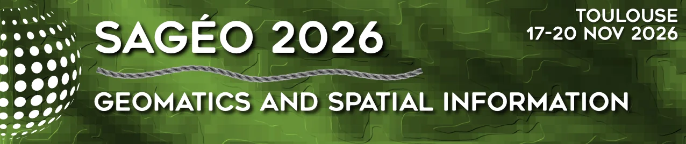](https://sageo2026.sciencesconf.org/?lang=fr)

# Comment représenter l’accessibilité urbaine ?

Cartes et rejeu d’itinéraires pour l’atelier sur l’accessibilité urbaine à Toulouse. [Guide interactif et jeux de données](https://www.maximspur.com/accessiviz/)

[Déposer vos productions](#productions) · [Comparer les durées](#start) · [Couches par durée](#budgets) · [Indicateurs communs](#shared) · [Destinations](#categories) · [Qualité des mailles](#quality) · [Contexte et tableaux](#context) · [Suivre un trajet](#calculation) · [Équipe de l’atelier](#workshop)

## Productions de l’atelier

**[Déposer vos productions sur ShareDocs](https://sharedocs.huma-num.fr/wl/?id=vuYaF43INPyqNSy62W2VL1VktpfjYSSB&path=Productions&mode=grid)**

## Téléchargements QGIS

- [Marche seulement (108,2 MB)](https://github.com/MaxSpur/JE-AccessiViz/releases/download/sageo-2026-donnees/toulouse-walking-only-v3.zip) · [Dossier ShareDocs](https://sharedocs.huma-num.fr/wl/?id=vuYaF43INPyqNSy62W2VL1VktpfjYSSB&path=Ressources%2FDonnees%2Fwalking&mode=grid)
- [Transports sans attente seulement (80,3 MB)](https://github.com/MaxSpur/JE-AccessiViz/releases/download/sageo-2026-donnees/toulouse-no-wait-transit-only-v4.zip) · [Dossier ShareDocs (édition précédente)](https://sharedocs.huma-num.fr/wl/?id=vuYaF43INPyqNSy62W2VL1VktpfjYSSB&path=Ressources%2FDonnees%2Ftransit&mode=grid)
- [Les deux modes (172,1 MB)](https://github.com/MaxSpur/JE-AccessiViz/releases/download/sageo-2026-donnees/toulouse-walking-and-no-wait-transit-v5.zip) · [Dossier ShareDocs (édition précédente)](https://sharedocs.huma-num.fr/wl/?id=vuYaF43INPyqNSy62W2VL1VktpfjYSSB&path=Ressources%2FDonnees%2Fwalking%2Btransit&mode=grid)

Décompressez le ZIP et ouvrez workshop.qgs.

## Proximité des destinations à pied

Quels commerces, services et autres lieux peut-on rejoindre à pied à proximité ? Depuis chaque maille, on cherche le trajet à pied le plus court vers un lieu de chacune des neuf catégories. Plus les trajets sont courts, plus le **score de proximité** est élevé. La carte à 5 minutes privilégie les lieux les plus proches. Les cartes à 10 et 15 minutes utilisent les mêmes trajets et donnent plus de points aux trajets longs.

Comparez la **marche** et la **marche avec transports sans attente** ci-dessous. Le second mode retient le trajet le plus rapide, y compris à pied. La montée est immédiate. La durée inclut la marche, le temps à bord, les arrêts en cours de trajet et les correspondances.

[Télécharger l’atlas (PDF A3, 36 pages, 58,0 Mo)](accessiviz-assets/atlas-accessiviz-a3.pdf?raw=true)

**PDF A3** pour imprimer. Chaque maille de 50 m est dessinée comme un rectangle vectoriel pour conserver des contours nets à l’agrandissement. Les titres, légendes et couches de contexte sont aussi vectoriels.

**PNG 50 m** pour récupérer la carte en couleurs. L’image sans perte fait 715 × 1 029 pixels, avec un pixel par maille et un fond transparent hors des zones renseignées. Les GeoTIFF des archives QGIS contiennent les valeurs numériques et leur géoréférencement.

| 5 min | 10 min | 15 min |
|----|----|----|
| 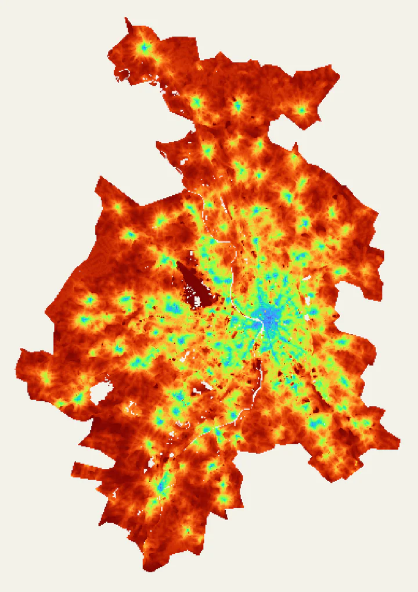 |  | 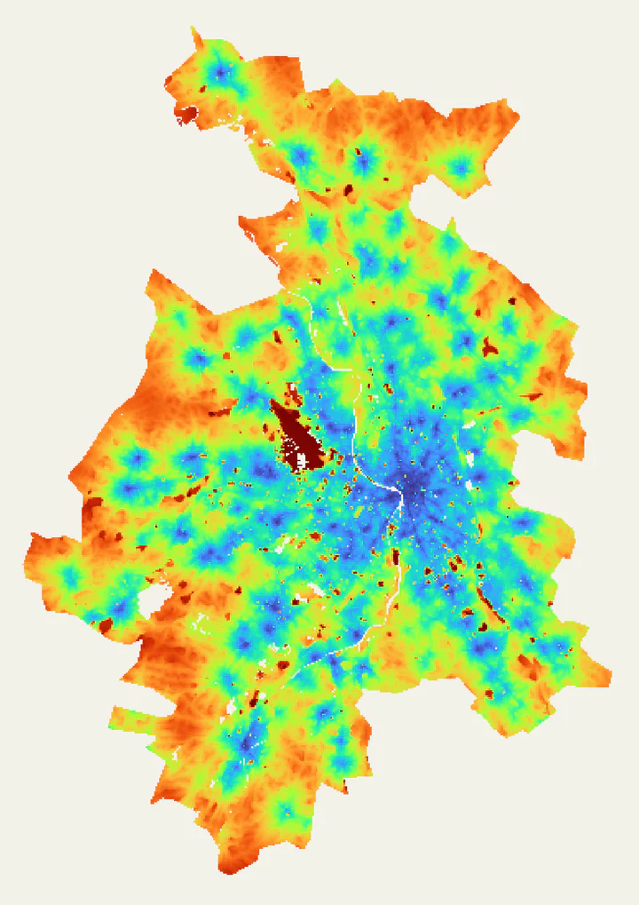 |
| [PDF A3](accessiviz-assets/print-maps/proximite-des-destinations-marche-5-minutes.pdf?raw=true) | [PDF A3](accessiviz-assets/print-maps/proximite-des-destinations-marche-10-minutes.pdf?raw=true) | [PDF A3](accessiviz-assets/print-maps/proximite-des-destinations-marche-15-minutes.pdf?raw=true) |
| [PNG 50 m](accessiviz-assets/raster-maps/proximite-des-destinations-marche-5-minutes.png?raw=true) | [PNG 50 m](accessiviz-assets/raster-maps/proximite-des-destinations-marche-10-minutes.png?raw=true) | [PNG 50 m](accessiviz-assets/raster-maps/proximite-des-destinations-marche-15-minutes.png?raw=true) |

**Proximité des destinations (%)**

 0 ·  25 ·  50 ·  75 ·  100

Ces trois aperçus moyennent les valeurs valides des mailles de 50 m dans des carrés de 100 m. Les autres cartes utilisent les couches QGIS sur la même emprise. [Voir la formule et un exemple.](#nearest-access) [Voir le score qui tient aussi compte du nombre de lieux proches.](#ranked-access)

Ouvrir le projet dans QGIS

Décompressez le ZIP et ouvrez **workshop.qgs**. Dans le panneau des couches, utilisez les **Thèmes de carte** pour comparer la marche et la marche avec transports sans attente à 5, 10 et 15 minutes. Les noms des couches et les fichiers CSV sont en anglais.

## Couches calculées par durée

Les cartes comparées utilisent la même échelle. Les nombres de lieux, le choix de destinations et l’accès selon le rang sont disponibles pour la marche.

Une maille vide indique que le modèle n’a pas de point de départ à cet endroit. Sur les cartes qui nécessitent un temps pour chaque catégorie, le gris indique que le modèle a un point de départ mais n’a trouvé aucun trajet pour au moins une catégorie. Voir la [qualité des mailles](#quality).

### Proximité des destinations (%)

#### Marche

| Marche · 5 min | Marche · 10 min | Marche · 15 min |
|----|----|----|
|  | 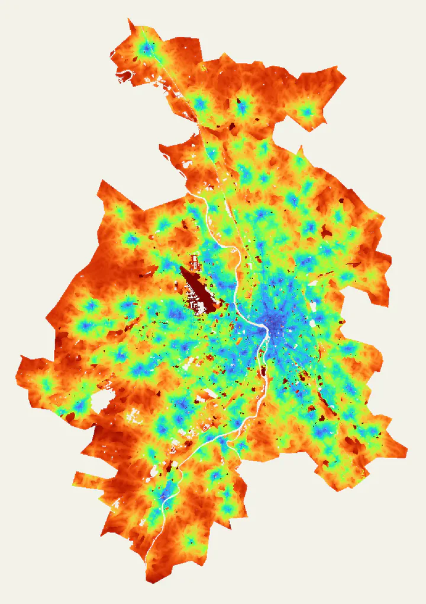 |  |

 0 ·  25 ·  50 ·  75 ·  100

PDF A3 · [5 min](accessiviz-assets/print-maps/proximite-des-destinations-marche-5-minutes.pdf?raw=true) · [10 min](accessiviz-assets/print-maps/proximite-des-destinations-marche-10-minutes.pdf?raw=true) · [15 min](accessiviz-assets/print-maps/proximite-des-destinations-marche-15-minutes.pdf?raw=true)

PNG 50 m · [5 min](accessiviz-assets/raster-maps/proximite-des-destinations-marche-5-minutes.png?raw=true) · [10 min](accessiviz-assets/raster-maps/proximite-des-destinations-marche-10-minutes.png?raw=true) · [15 min](accessiviz-assets/raster-maps/proximite-des-destinations-marche-15-minutes.png?raw=true)

#### Marche + transports sans attente

| Marche + transports sans attente · 5 min | Marche + transports sans attente · 10 min | Marche + transports sans attente · 15 min |
|----|----|----|
| 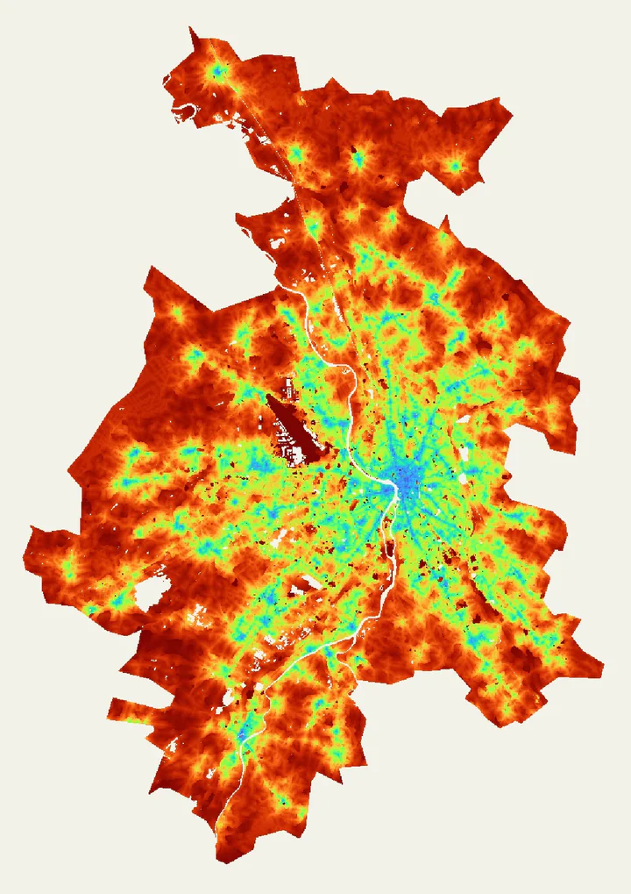 | 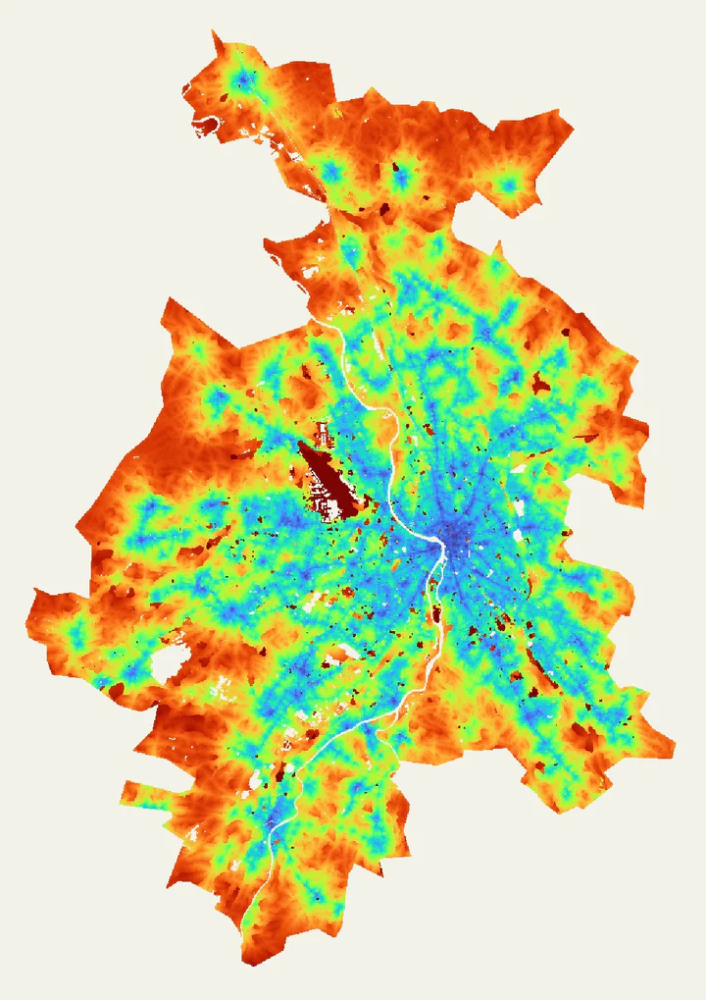 | 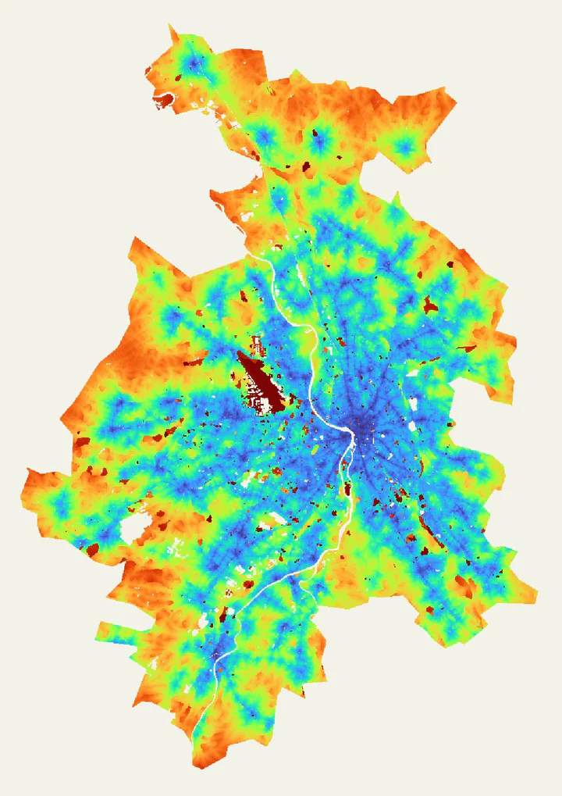 |

 0 ·  25 ·  50 ·  75 ·  100

PDF A3 · [5 min](accessiviz-assets/print-maps/proximite-des-destinations-marche-et-transports-sans-attente-5-minutes.pdf?raw=true) · [10 min](accessiviz-assets/print-maps/proximite-des-destinations-marche-et-transports-sans-attente-10-minutes.pdf?raw=true) · [15 min](accessiviz-assets/print-maps/proximite-des-destinations-marche-et-transports-sans-attente-15-minutes.pdf?raw=true)

PNG 50 m · [5 min](accessiviz-assets/raster-maps/proximite-des-destinations-marche-et-transports-sans-attente-5-minutes.png?raw=true) · [10 min](accessiviz-assets/raster-maps/proximite-des-destinations-marche-et-transports-sans-attente-10-minutes.png?raw=true) · [15 min](accessiviz-assets/raster-maps/proximite-des-destinations-marche-et-transports-sans-attente-15-minutes.png?raw=true)

On part d’une maille. Pour chacune des neuf catégories, on cherche le trajet le plus rapide vers un lieu de cette catégorie. On attribue à chaque catégorie un score de 0 à 100 selon la durée du trajet, puis on fait la moyenne des neuf scores.

**Sur la carte à 5 minutes, chaque tranche de 5 minutes supplémentaires divise par deux le score de la catégorie.** Un lieu au point de départ vaut 100 points. Le score passe à 50 pour un trajet de 5 minutes, à 25 pour 10 minutes et à 12,5 pour 15 minutes. Entre ces durées, il baisse progressivement. Sur les deux autres cartes, le score est divisé par deux toutes les 10 ou 15 minutes, selon la carte.

Score de la catégorie = 100 × 2−t/T

*t* est la durée du trajet le plus court en minutes et *T* vaut 5, 10 ou 15 minutes. Une catégorie sans itinéraire dans le modèle vaut zéro. Les deux modes utilisent la même formule et la même échelle de couleurs.

### Couverture des catégories (%)

#### Marche

| Marche · 5 min | Marche · 10 min | Marche · 15 min |
|----|----|----|
| 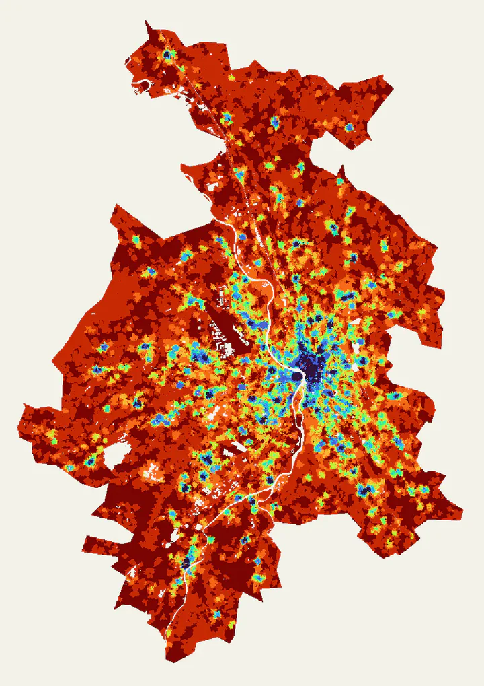 | 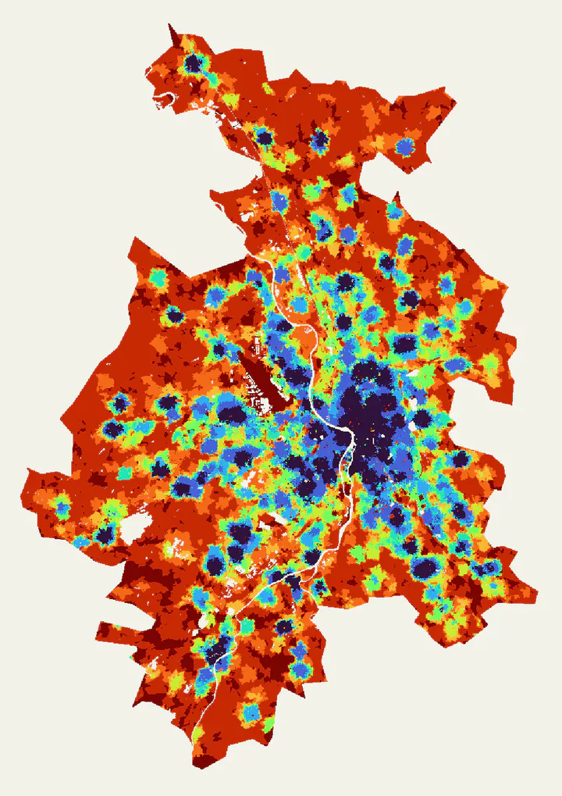 | 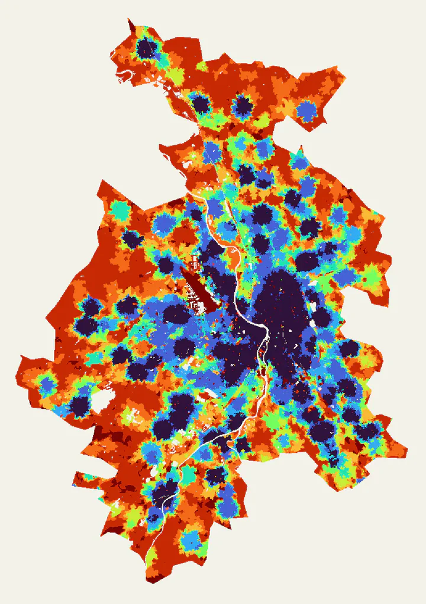 |

 0 ·  25 ·  50 ·  75 ·  100

PDF A3 · [5 min](accessiviz-assets/print-maps/couverture-des-categories-marche-5-minutes.pdf?raw=true) · [10 min](accessiviz-assets/print-maps/couverture-des-categories-marche-10-minutes.pdf?raw=true) · [15 min](accessiviz-assets/print-maps/couverture-des-categories-marche-15-minutes.pdf?raw=true)

PNG 50 m · [5 min](accessiviz-assets/raster-maps/couverture-des-categories-marche-5-minutes.png?raw=true) · [10 min](accessiviz-assets/raster-maps/couverture-des-categories-marche-10-minutes.png?raw=true) · [15 min](accessiviz-assets/raster-maps/couverture-des-categories-marche-15-minutes.png?raw=true)

#### Marche + transports sans attente

| Marche + transports sans attente · 5 min | Marche + transports sans attente · 10 min | Marche + transports sans attente · 15 min |
|----|----|----|
| 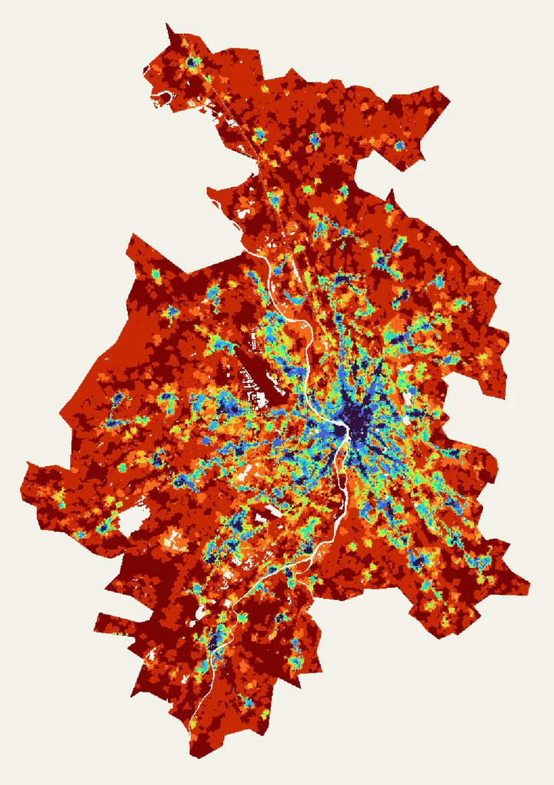 | 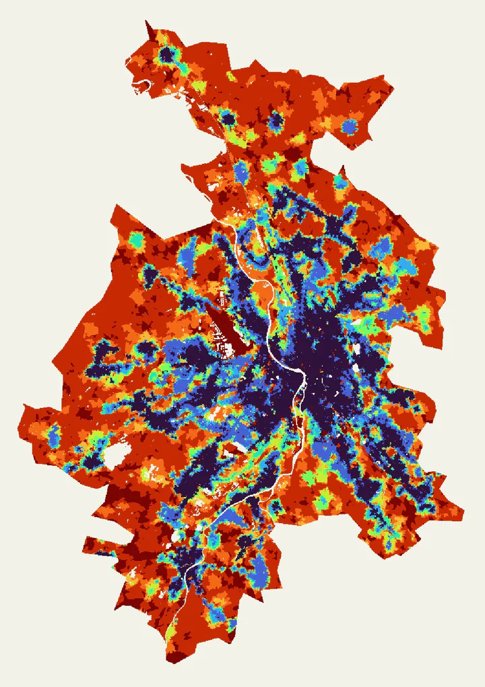 | 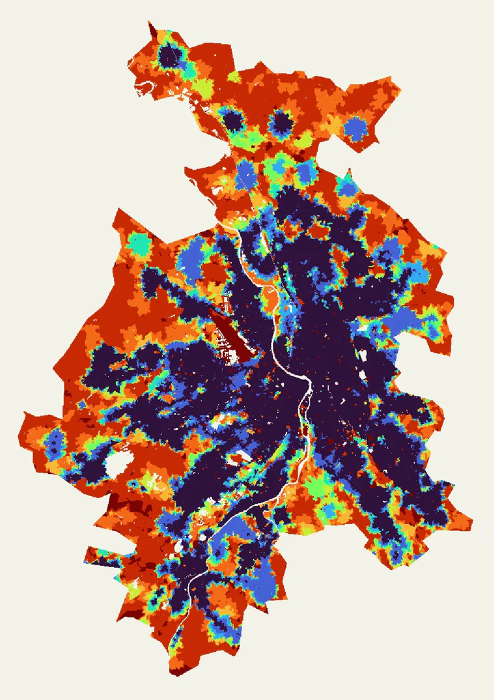 |

 0 ·  25 ·  50 ·  75 ·  100

PDF A3 · [5 min](accessiviz-assets/print-maps/couverture-des-categories-marche-et-transports-sans-attente-5-minutes.pdf?raw=true) · [10 min](accessiviz-assets/print-maps/couverture-des-categories-marche-et-transports-sans-attente-10-minutes.pdf?raw=true) · [15 min](accessiviz-assets/print-maps/couverture-des-categories-marche-et-transports-sans-attente-15-minutes.pdf?raw=true)

PNG 50 m · [5 min](accessiviz-assets/raster-maps/couverture-des-categories-marche-et-transports-sans-attente-5-minutes.png?raw=true) · [10 min](accessiviz-assets/raster-maps/couverture-des-categories-marche-et-transports-sans-attente-10-minutes.png?raw=true) · [15 min](accessiviz-assets/raster-maps/couverture-des-categories-marche-et-transports-sans-attente-15-minutes.png?raw=true)

Pour une durée donnée, on compte les catégories dont au moins un lieu est accessible dans le temps imparti. On divise ce nombre par neuf. Si l’on peut rejoindre un commerce alimentaire, une pharmacie et un café en cinq minutes et qu’ils représentent les seules catégories accessibles, la couverture est de 3 sur 9, soit 33 %.

Couverture = 100 × nombre de catégories accessibles ÷ 9

Un seul lieu suffit pour que sa catégorie soit comptée.

### Rapport de temps maximal

#### Marche

| Marche · 5 min | Marche · 10 min | Marche · 15 min |
|----|----|----|
|  | 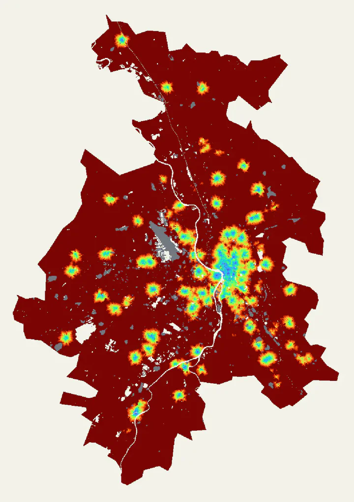 | 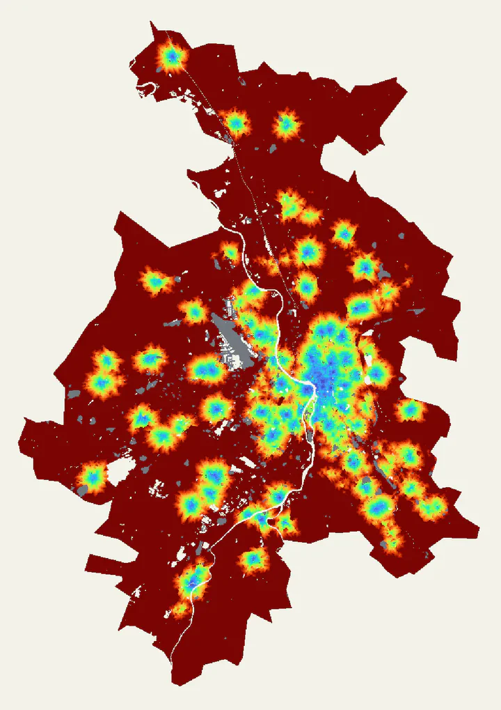 |

 Trajet manquant ·  0 ·  0,375 ·  0,75 ·  1,125 ·  ≥ 1,5

PDF A3 · [5 min](accessiviz-assets/print-maps/rapport-de-temps-maximal-marche-5-minutes.pdf?raw=true) · [10 min](accessiviz-assets/print-maps/rapport-de-temps-maximal-marche-10-minutes.pdf?raw=true) · [15 min](accessiviz-assets/print-maps/rapport-de-temps-maximal-marche-15-minutes.pdf?raw=true)

PNG 50 m · [5 min](accessiviz-assets/raster-maps/rapport-de-temps-maximal-marche-5-minutes.png?raw=true) · [10 min](accessiviz-assets/raster-maps/rapport-de-temps-maximal-marche-10-minutes.png?raw=true) · [15 min](accessiviz-assets/raster-maps/rapport-de-temps-maximal-marche-15-minutes.png?raw=true)

#### Marche + transports sans attente

| Marche + transports sans attente · 5 min | Marche + transports sans attente · 10 min | Marche + transports sans attente · 15 min |
|----|----|----|
|  | 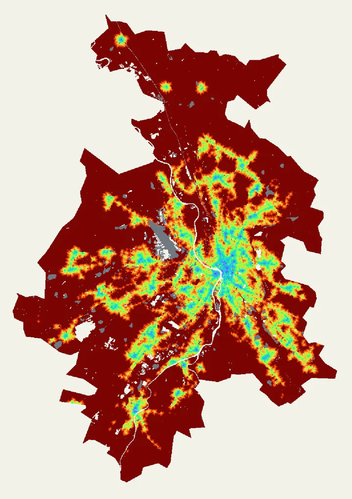 | 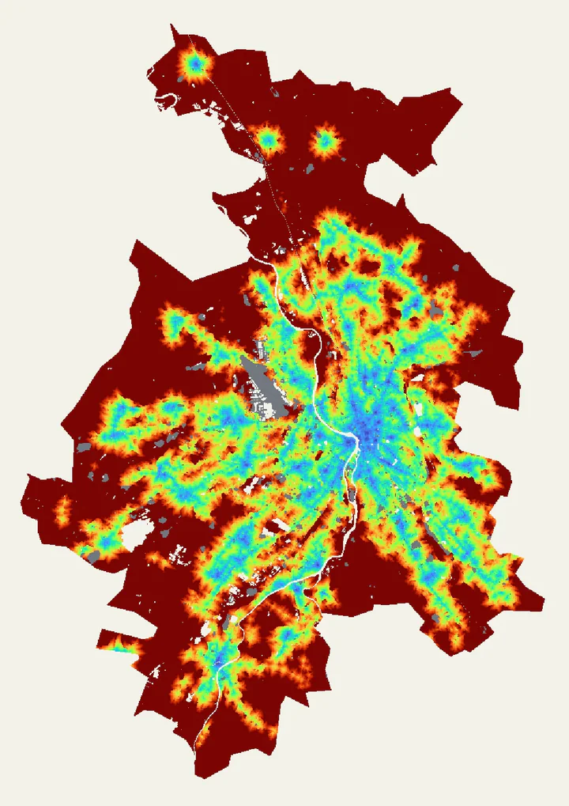 |

 Trajet manquant ·  0 ·  0,375 ·  0,75 ·  1,125 ·  ≥ 1,5

PDF A3 · [5 min](accessiviz-assets/print-maps/rapport-de-temps-maximal-marche-et-transports-sans-attente-5-minutes.pdf?raw=true) · [10 min](accessiviz-assets/print-maps/rapport-de-temps-maximal-marche-et-transports-sans-attente-10-minutes.pdf?raw=true) · [15 min](accessiviz-assets/print-maps/rapport-de-temps-maximal-marche-et-transports-sans-attente-15-minutes.pdf?raw=true)

PNG 50 m · [5 min](accessiviz-assets/raster-maps/rapport-de-temps-maximal-marche-et-transports-sans-attente-5-minutes.png?raw=true) · [10 min](accessiviz-assets/raster-maps/rapport-de-temps-maximal-marche-et-transports-sans-attente-10-minutes.png?raw=true) · [15 min](accessiviz-assets/raster-maps/rapport-de-temps-maximal-marche-et-transports-sans-attente-15-minutes.png?raw=true)

Depuis la même maille, on cherche le trajet le plus court dans chaque catégorie. On divise le plus long de ces neuf temps par le temps imparti. Si le trajet le plus long dure 12 minutes et que l’on dispose de 10 minutes, le rapport vaut 1,2. Un rapport inférieur ou égal à 1 signifie que les neuf catégories sont accessibles dans le temps imparti.

L’échelle de couleurs s’arrête à 1,5. Dans QGIS, la bande 1 donne la valeur réelle.

### Toutes les catégories accessibles

#### Marche

| Marche · 5 min | Marche · 10 min | Marche · 15 min |
|----|----|----|
| 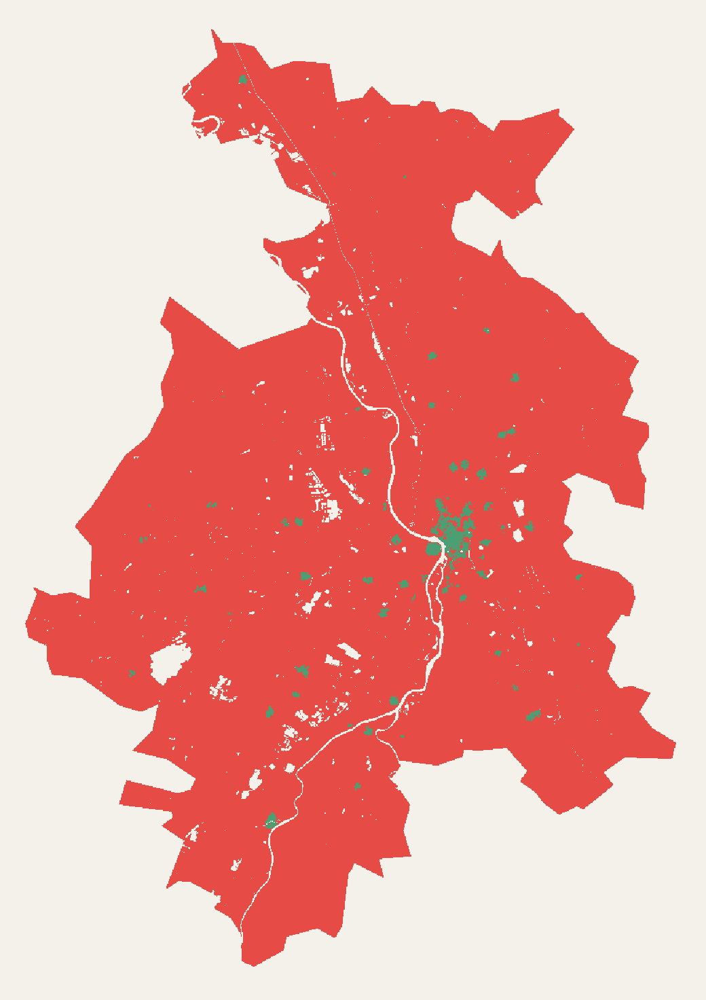 | 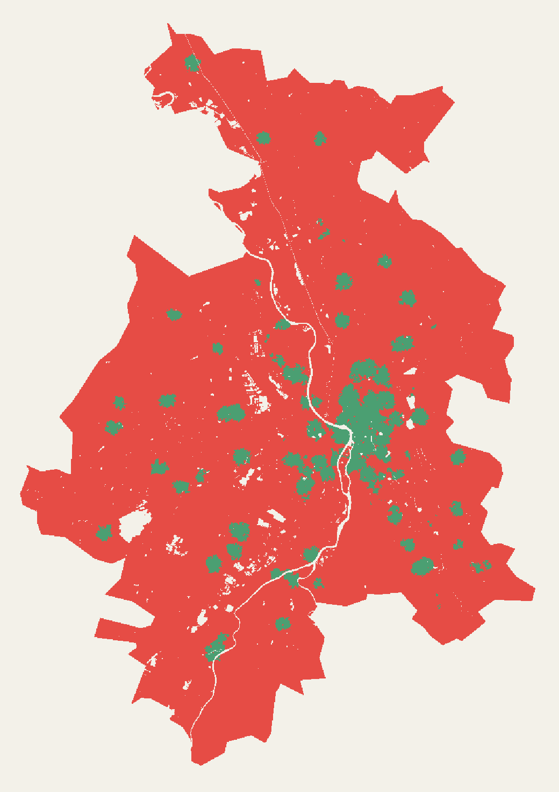 |  |

 Catégorie manquante ·  Toutes accessibles

PDF A3 · [5 min](accessiviz-assets/print-maps/toutes-les-categories-accessibles-marche-5-minutes.pdf?raw=true) · [10 min](accessiviz-assets/print-maps/toutes-les-categories-accessibles-marche-10-minutes.pdf?raw=true) · [15 min](accessiviz-assets/print-maps/toutes-les-categories-accessibles-marche-15-minutes.pdf?raw=true)

PNG 50 m · [5 min](accessiviz-assets/raster-maps/toutes-les-categories-accessibles-marche-5-minutes.png?raw=true) · [10 min](accessiviz-assets/raster-maps/toutes-les-categories-accessibles-marche-10-minutes.png?raw=true) · [15 min](accessiviz-assets/raster-maps/toutes-les-categories-accessibles-marche-15-minutes.png?raw=true)

#### Marche + transports sans attente

| Marche + transports sans attente · 5 min | Marche + transports sans attente · 10 min | Marche + transports sans attente · 15 min |
|----|----|----|
|  | 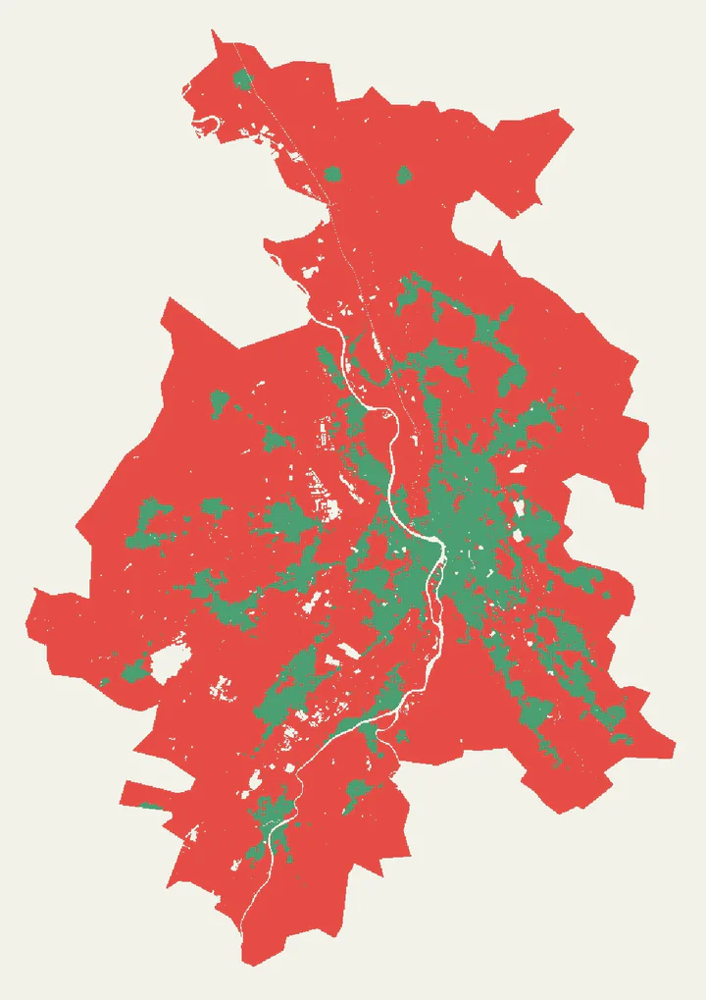 | 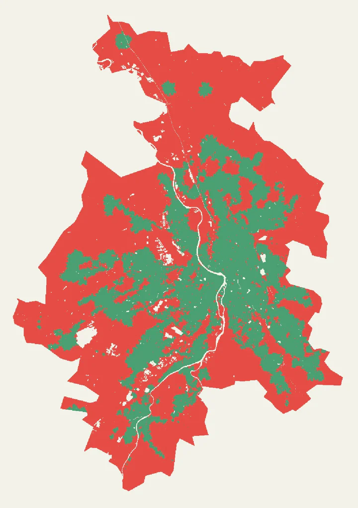 |

 Catégorie manquante ·  Toutes accessibles

PDF A3 · [5 min](accessiviz-assets/print-maps/toutes-les-categories-accessibles-marche-et-transports-sans-attente-5-minutes.pdf?raw=true) · [10 min](accessiviz-assets/print-maps/toutes-les-categories-accessibles-marche-et-transports-sans-attente-10-minutes.pdf?raw=true) · [15 min](accessiviz-assets/print-maps/toutes-les-categories-accessibles-marche-et-transports-sans-attente-15-minutes.pdf?raw=true)

PNG 50 m · [5 min](accessiviz-assets/raster-maps/toutes-les-categories-accessibles-marche-et-transports-sans-attente-5-minutes.png?raw=true) · [10 min](accessiviz-assets/raster-maps/toutes-les-categories-accessibles-marche-et-transports-sans-attente-10-minutes.png?raw=true) · [15 min](accessiviz-assets/raster-maps/toutes-les-categories-accessibles-marche-et-transports-sans-attente-15-minutes.png?raw=true)

Peut-on rejoindre au moins un lieu de chacune des neuf catégories dans le temps imparti ? Le vert indique que les neuf catégories sont accessibles. Le rouge signifie qu’il manque au moins une catégorie.

### Choix de destinations (%)

| Marche · 5 min | Marche · 10 min | Marche · 15 min |
|----|----|----|
|  | 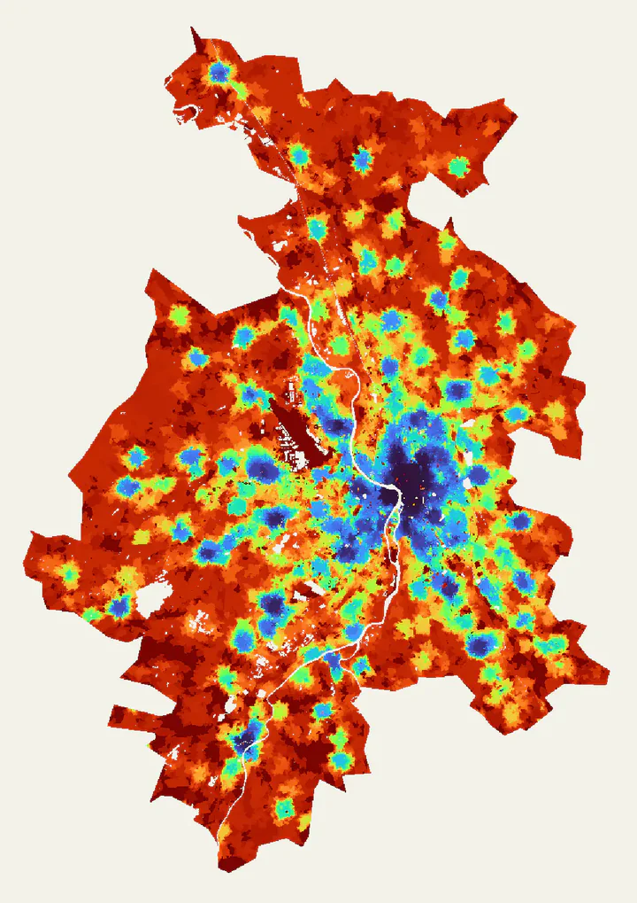 | 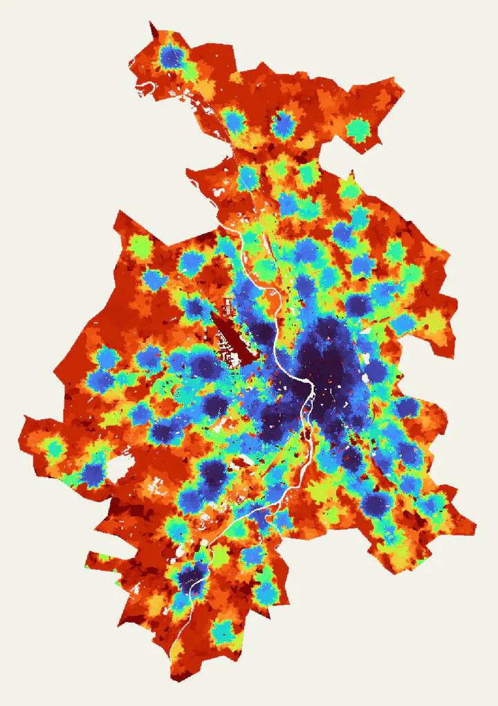 |

 0 ·  25 ·  50 ·  75 ·  100

PDF A3 · [5 min](accessiviz-assets/print-maps/choix-de-destinations-marche-5-minutes.pdf?raw=true) · [10 min](accessiviz-assets/print-maps/choix-de-destinations-marche-10-minutes.pdf?raw=true) · [15 min](accessiviz-assets/print-maps/choix-de-destinations-marche-15-minutes.pdf?raw=true)

PNG 50 m · [5 min](accessiviz-assets/raster-maps/choix-de-destinations-marche-5-minutes.png?raw=true) · [10 min](accessiviz-assets/raster-maps/choix-de-destinations-marche-10-minutes.png?raw=true) · [15 min](accessiviz-assets/raster-maps/choix-de-destinations-marche-15-minutes.png?raw=true)

Pour une durée donnée, on compte les lieux distincts accessibles dans chaque catégorie. On convertit chaque nombre en un score de 0 à 100, puis on fait la moyenne des neuf scores. Passer de zéro café à un fait davantage monter le score de la restauration que de passer de dix à onze.

Chaque catégorie a un nombre de lieux de référence. Pour l’alimentation, ce nombre est de quatre. Un commerce alimentaire accessible donne environ 53 points à la catégorie et quatre commerces lui en donnent environ 95.

Score de la catégorie = 100 × (1 − e−3n/s)

*n* est le nombre de lieux accessibles et *s* est le [nombre de référence](#category-definitions) de la catégorie. Cet indicateur est disponible pour la marche.

### Catégorie limitante

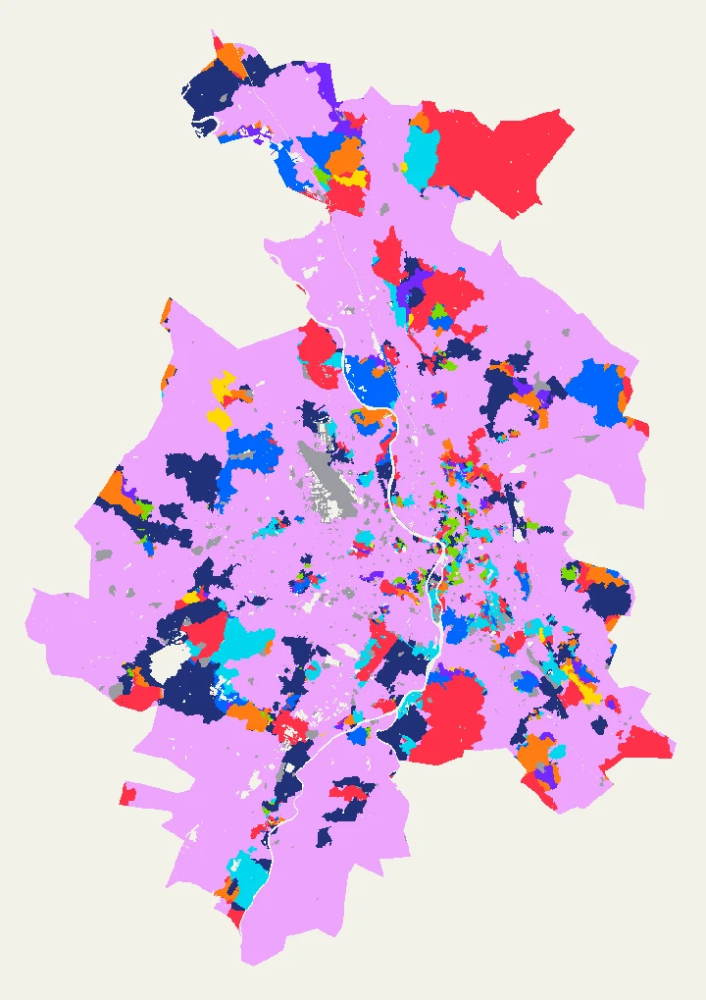

Marche + transports sans attente

 Alimentation ·  Santé ·  Éducation ·  Loisirs ·  Restauration ·  Commerces et services ·  Services civiques ·  Nature ·  Culture ·  Trajet manquant

[PDF A3](accessiviz-assets/print-maps/categorie-limitante-marche-et-transports-sans-attente.pdf?raw=true) · [PNG 50 m](accessiviz-assets/raster-maps/categorie-limitante-marche-et-transports-sans-attente.png?raw=true)

Depuis la maille, on cherche le trajet le plus court dans chaque catégorie. La catégorie limitante est celle dont le trajet est le plus long parmi ces neuf trajets. Si le cabinet médical le plus proche est à 18 minutes et que toutes les autres catégories demandent moins de temps, la catégorie limitante est la santé.

Cette carte utilise le profil sans attente. Le gris indique qu’au moins une catégorie est sans itinéraire dans le modèle.

### Catégorie la plus proche

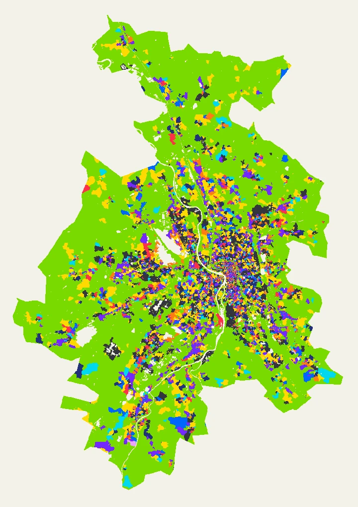

Marche + transports sans attente

 Alimentation ·  Santé ·  Éducation ·  Loisirs ·  Restauration ·  Commerces et services ·  Services civiques ·  Nature ·  Culture ·  Catégories à égalité

[PDF A3](accessiviz-assets/print-maps/categorie-la-plus-proche-marche-et-transports-sans-attente.pdf?raw=true) · [PNG 50 m](accessiviz-assets/raster-maps/categorie-la-plus-proche-marche-et-transports-sans-attente.png?raw=true)

On compare les trajets les plus courts vers chacune des neuf catégories. La couleur indique la catégorie que l’on rejoint le plus vite à pied ou avec les transports sans attente. La comparaison utilise les durées complètes et vaut pour les vues à 5, 10 et 15 minutes.

Le gris foncé indique une égalité entre plusieurs catégories. Une maille reste vide si le modèle ne trouve aucun trajet vers une destination.

### Accès aux destinations selon leur rang (%)

#### Marche

| Marche · 5 min | Marche · 10 min | Marche · 15 min |
|----|----|----|
| 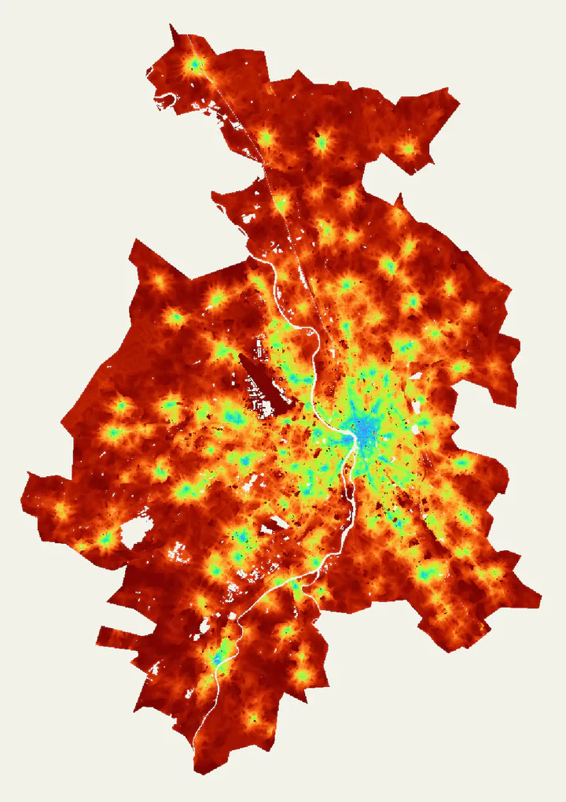 | 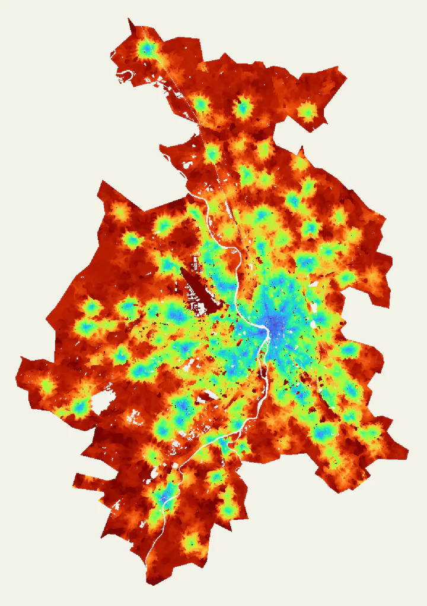 | 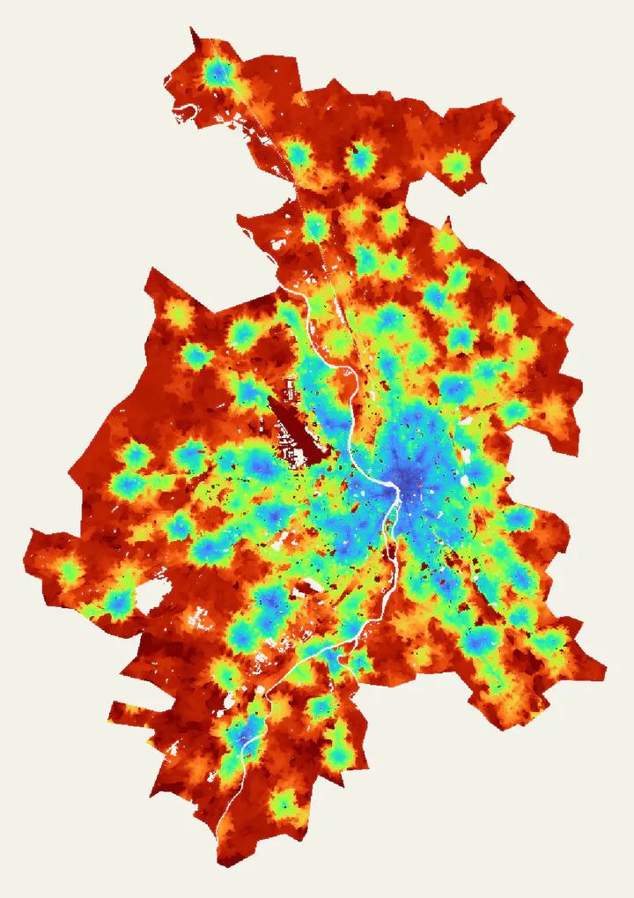 |

 0 ·  25 ·  50 ·  75 ·  100

PDF A3 · [5 min](accessiviz-assets/print-maps/acces-aux-destinations-selon-leur-rang-marche-5-minutes.pdf?raw=true) · [10 min](accessiviz-assets/print-maps/acces-aux-destinations-selon-leur-rang-marche-10-minutes.pdf?raw=true) · [15 min](accessiviz-assets/print-maps/acces-aux-destinations-selon-leur-rang-marche-15-minutes.pdf?raw=true)

PNG 50 m · [5 min](accessiviz-assets/raster-maps/acces-aux-destinations-selon-leur-rang-marche-5-minutes.png?raw=true) · [10 min](accessiviz-assets/raster-maps/acces-aux-destinations-selon-leur-rang-marche-10-minutes.png?raw=true) · [15 min](accessiviz-assets/raster-maps/acces-aux-destinations-selon-leur-rang-marche-15-minutes.png?raw=true)

Depuis une maille, on classe les lieux de chaque catégorie du plus rapide au plus long à rejoindre. Le premier vaut au départ 50 points, le deuxième 25, le troisième 12,5, et ainsi de suite. On réduit ensuite les points de chaque lieu selon la durée du trajet.

Sur la carte à 5 minutes, chaque tranche de 5 minutes de trajet divise les points d’un lieu par deux. Un commerce alimentaire à 5 minutes donne 25 points. Un deuxième à 10 minutes en ajoute 6,25. À eux deux, ils donnent 31,25 points à la catégorie Alimentation. On additionne les points dans chaque catégorie, puis on fait la moyenne des neuf totaux.

Points par lieu = 100 × 2−r − t/T

*r* est le rang (1 pour le premier), *t* la durée du trajet en minutes et *T* le nombre de minutes indiqué sur la carte.

Les trois cartes incluent les trajets de 15 minutes ou moins. Sur les cartes à 10 et 15 minutes, les points d’un lieu sont divisés par deux toutes les 10 et 15 minutes, respectivement. Cet indicateur est disponible pour la marche.

## Indicateurs communs aux durées

Les temps de trajet ne changent pas lorsque vous changez de seuil. Les temps minimums par catégorie figurent dans [Destinations](#categories).

### Temps pour atteindre chaque catégorie (min) · Marche

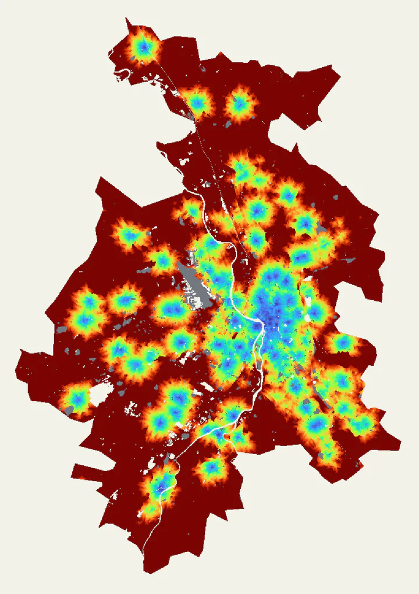

Marche

 Trajet manquant ·  0 ·  7,5 ·  15 ·  22,5 ·  ≥ 30 min

[PDF A3](accessiviz-assets/print-maps/temps-pour-atteindre-chaque-categorie-marche.pdf?raw=true) · [PNG 50 m](accessiviz-assets/raster-maps/temps-pour-atteindre-chaque-categorie-marche.png?raw=true)

Depuis chaque maille, on cherche le trajet à pied le plus rapide vers un lieu de chacune des neuf catégories. La carte indique la durée du plus long de ces trajets. Par exemple, elle affiche 18 minutes si le cabinet médical le plus proche est à 18 minutes à pied et que toutes les autres catégories sont plus proches.

Le gris indique que le modèle ne trouve aucun trajet à pied pour au moins une catégorie. L’échelle de couleurs s’arrête à 30 minutes. Dans QGIS, la bande 1 donne la durée réelle.

### Temps pour atteindre chaque catégorie (min) · Transports sans attente

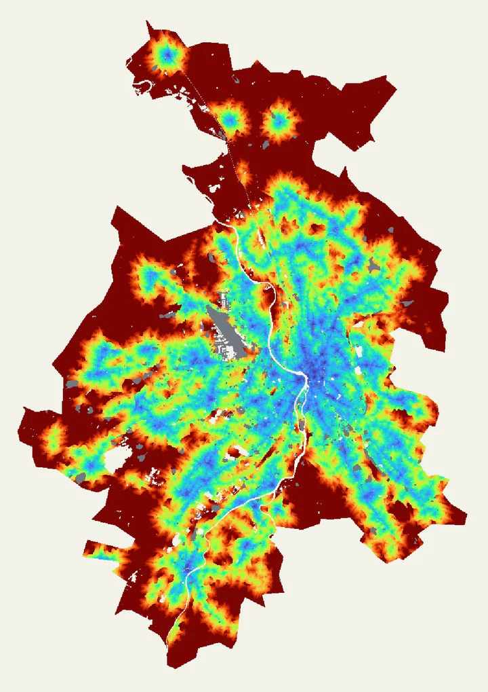

Marche et transports · sans attente à la montée

 Trajet manquant ·  0 ·  7,5 ·  15 ·  22,5 ·  ≥ 30 min

[PDF A3](accessiviz-assets/print-maps/temps-pour-atteindre-chaque-categorie-marche-et-transports-sans-attente.pdf?raw=true) · [PNG 50 m](accessiviz-assets/raster-maps/temps-pour-atteindre-chaque-categorie-marche-et-transports-sans-attente.png?raw=true)

Et si un véhicule était prêt à partir chaque fois que vous arrivez à un arrêt ? Le modèle utilise les trajets Tisséo des deux jours de service de l’atelier et suppose que l’on peut monter sans attendre. Il compte le temps de marche, le temps à bord et les correspondances. La marche jusqu’au premier arrêt peut dépasser 15 minutes. Les correspondances à pied estimées sont limitées à 15 minutes.

Pour chaque catégorie, il retient le trajet le plus rapide sur l’un des deux jours ou à pied. La carte montre le plus long de ces neuf trajets. Elle représente des conditions favorables. Les trajets réels dépendent des horaires.

### Temps à pied jusqu’au point de montée le plus proche (min)

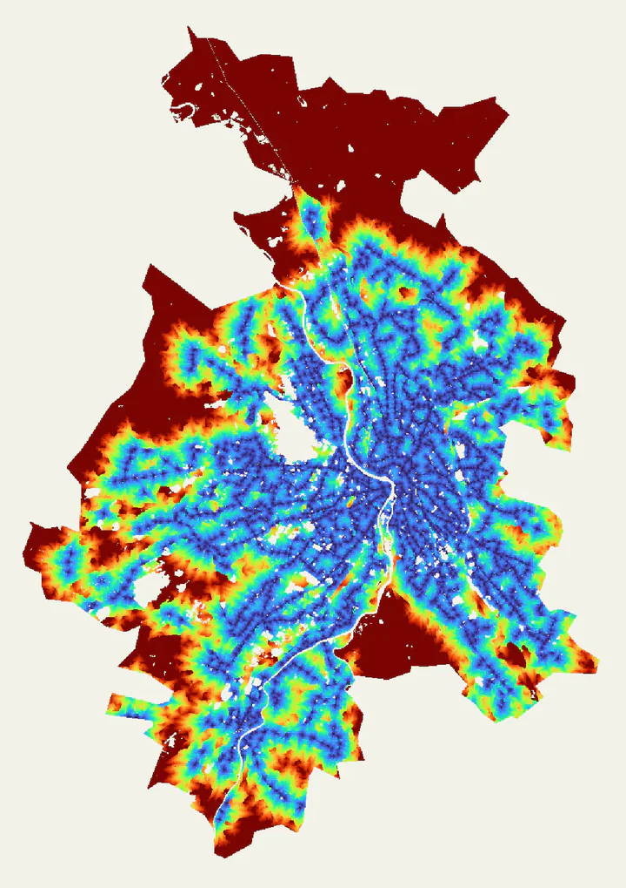

Marche · trajet jusqu’au point de montée

 0 ·  7,5 ·  15 ·  22,5 ·  ≥ 30 min

[PDF A3](accessiviz-assets/print-maps/temps-jusquau-point-de-montee-marche-jusquau-reseau-tisseo.pdf?raw=true) · [PNG 50 m](accessiviz-assets/raster-maps/temps-jusquau-point-de-montee-marche-jusquau-reseau-tisseo.png?raw=true)

La carte indique le temps de marche jusqu’au point de montée Tisséo le plus proche, desservi par au moins un départ sur l’un des deux jours de l’atelier. Le temps d’accès au quai est inclus. La carte indique la facilité d’accès au réseau avant l’attente du véhicule.

Les neuf catégories de destinations décrivent des lieux à visiter. Cette couche distincte décrit l’accès au réseau de transport lui-même. La couleur cesse de changer à 30 minutes. Dans QGIS, la bande 1 donne la durée réelle.

### Temps gagné grâce aux transports (min) · Sans attente

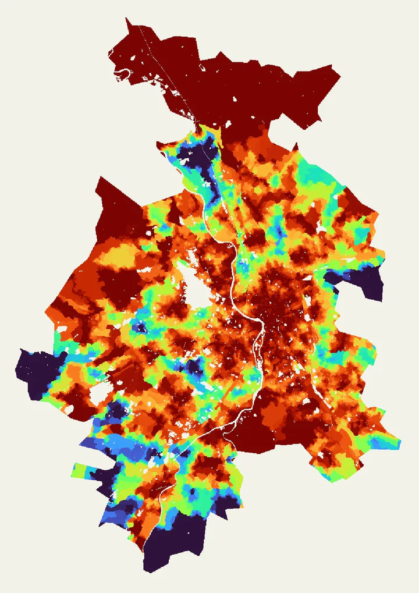

Temps à pied moins temps en transports sans attente

[PDF A3](accessiviz-assets/print-maps/temps-gagne-grace-aux-transports-marche-et-transports-sans-attente.pdf?raw=true) · [PNG 50 m](accessiviz-assets/raster-maps/temps-gagne-grace-aux-transports-marche-et-transports-sans-attente.png?raw=true)

On soustrait le temps pour atteindre chaque catégorie sans attente du temps à pied. Ici, 197 593 mailles gagnent au moins cinq minutes.

La différence est calculée à partir des durées complètes. L’échelle de couleurs va de 0 à 30 minutes. Le violet foncé correspond à 30 minutes gagnées ou plus. Une maille reste vide si l’un des deux temps est inconnu.

## Destinations par catégorie

Le **temps minimum** peut dépasser 15 minutes dans les deux modes. Le **nombre** compte les lieux distincts accessibles à pied dans le temps imparti. Un parc à plusieurs entrées ne compte qu’une fois.

Les **points** indiquent les lieux ponctuels et les **surfaces** leurs emprises. Dans QGIS, zoomez au 1:35 000 pour les points ou au 1:80 000 pour les surfaces.

Alimentation

#### Temps minimum · Alimentation · Marche

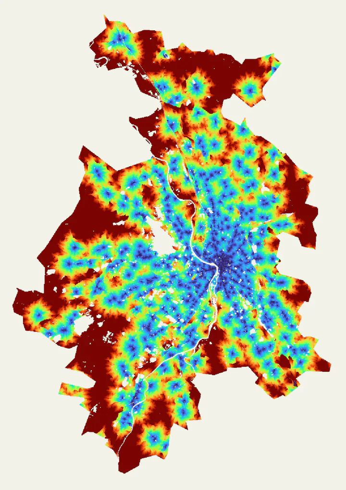

Marche

 0 ·  7,5 ·  15 ·  22,5 ·  ≥ 30 min

[PDF A3](accessiviz-assets/print-maps/alimentation-temps-a-pied-jusquau-lieu-le-plus-proche.pdf?raw=true) · [PNG 50 m](accessiviz-assets/raster-maps/alimentation-temps-a-pied-jusquau-lieu-le-plus-proche.png?raw=true)

Commerces alimentaires et marchés, dont les supermarchés, supérettes, primeurs et boulangeries.

#### Temps minimum · Alimentation · Transports sans attente

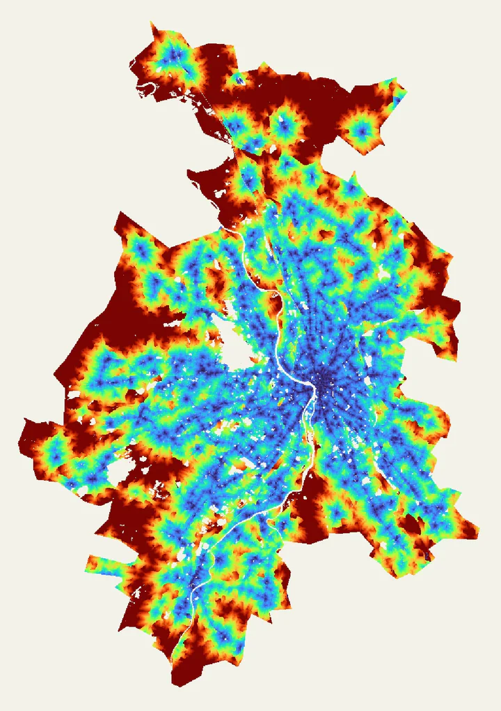

Marche + transports sans attente

 0 ·  7,5 ·  15 ·  22,5 ·  ≥ 30 min

[PDF A3](accessiviz-assets/print-maps/alimentation-temps-jusquau-lieu-le-plus-proche-en-transports-sans-attente.pdf?raw=true) · [PNG 50 m](accessiviz-assets/raster-maps/alimentation-temps-jusquau-lieu-le-plus-proche-en-transports-sans-attente.png?raw=true)

Trajet le plus rapide dans cette catégorie avec montée immédiate.

#### Nombre de lieux · Alimentation

| Marche · 5 min | Marche · 10 min | Marche · 15 min |
|----|----|----|
|  |  | 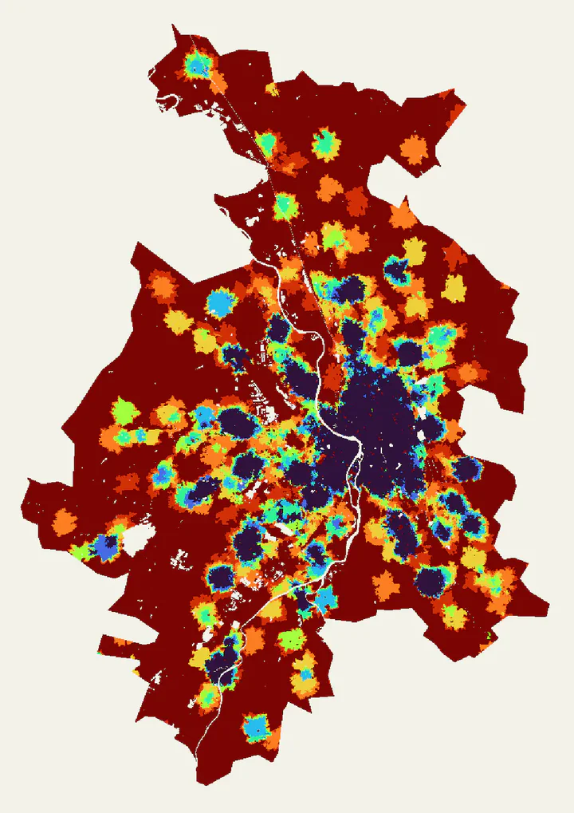 |

 0 ·  2 ·  4 ·  6 ·  ≥ 8

PDF A3 · [5 min](accessiviz-assets/print-maps/alimentation-nombre-de-lieux-a-5-minutes-a-pied.pdf?raw=true) · [10 min](accessiviz-assets/print-maps/alimentation-nombre-de-lieux-a-10-minutes-a-pied.pdf?raw=true) · [15 min](accessiviz-assets/print-maps/alimentation-nombre-de-lieux-a-15-minutes-a-pied.pdf?raw=true)

PNG 50 m · [5 min](accessiviz-assets/raster-maps/alimentation-nombre-de-lieux-a-5-minutes-a-pied.png?raw=true) · [10 min](accessiviz-assets/raster-maps/alimentation-nombre-de-lieux-a-10-minutes-a-pied.png?raw=true) · [15 min](accessiviz-assets/raster-maps/alimentation-nombre-de-lieux-a-15-minutes-a-pied.png?raw=true)

Nombre de lieux distincts de cette catégorie dans le temps de marche choisi. Zéro signifie qu’aucun lieu n’est atteint.

#### Points · Alimentation

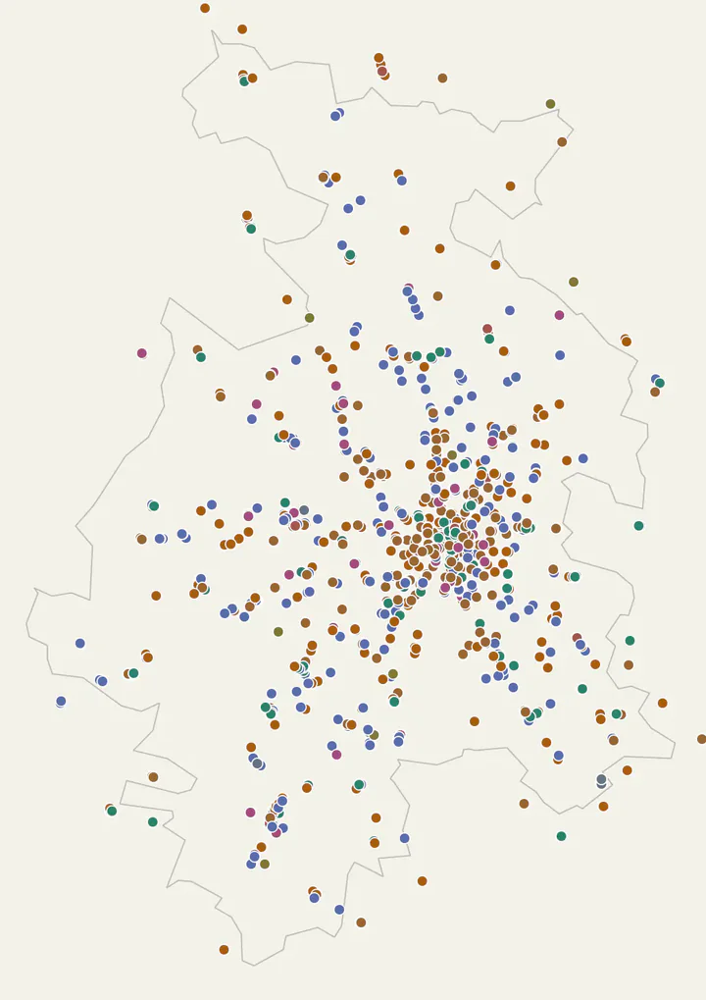

Emprise complète

[PDF A3](accessiviz-assets/print-maps/alimentation-lieux-representes-par-des-points.pdf?raw=true)

Lieux cartographiés comme points et colorés par sous-type.

#### Surfaces · Alimentation

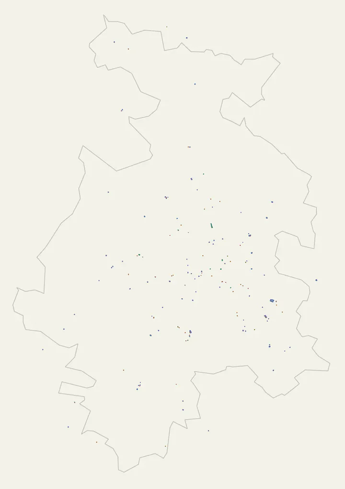

Emprise complète

[PDF A3](accessiviz-assets/print-maps/alimentation-emprises-des-lieux.pdf?raw=true)

Emprises cartographiées et colorées par sous-type.

Santé

#### Temps minimum · Santé · Marche

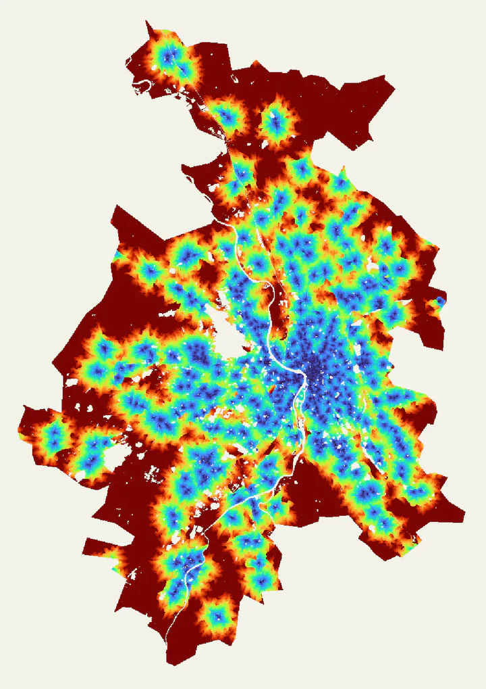

Marche

 0 ·  7,5 ·  15 ·  22,5 ·  ≥ 30 min

[PDF A3](accessiviz-assets/print-maps/sante-temps-a-pied-jusquau-lieu-le-plus-proche.pdf?raw=true) · [PNG 50 m](accessiviz-assets/raster-maps/sante-temps-a-pied-jusquau-lieu-le-plus-proche.png?raw=true)

Pharmacies, cliniques, hôpitaux, cabinets médicaux, dentistes et autres professionnels de santé.

#### Temps minimum · Santé · Transports sans attente

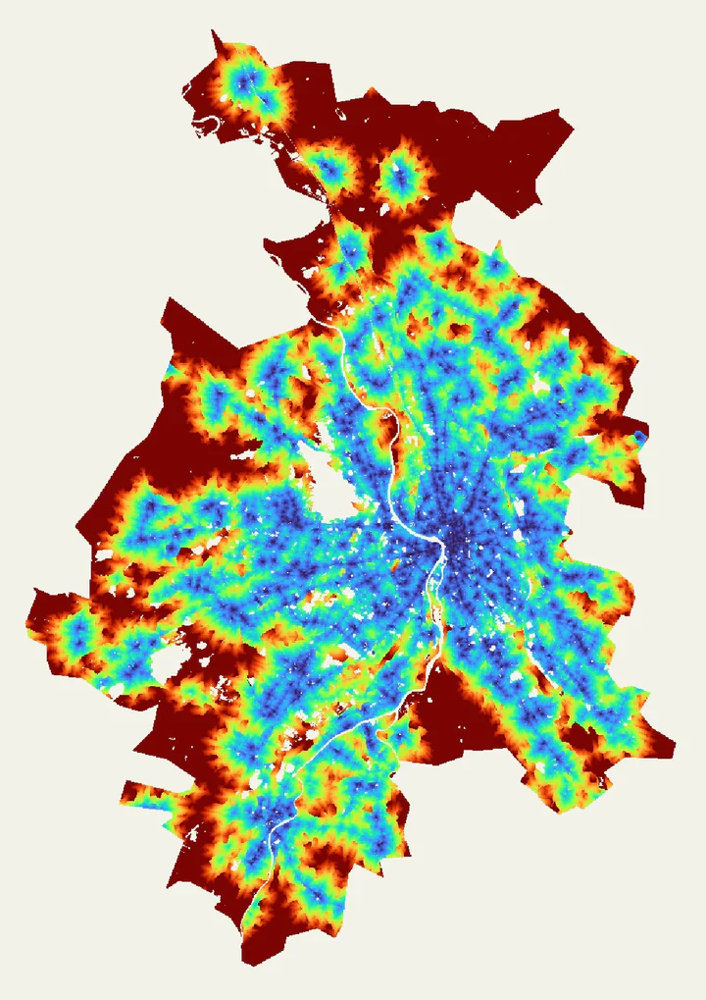

Marche + transports sans attente

 0 ·  7,5 ·  15 ·  22,5 ·  ≥ 30 min

[PDF A3](accessiviz-assets/print-maps/sante-temps-jusquau-lieu-le-plus-proche-en-transports-sans-attente.pdf?raw=true) · [PNG 50 m](accessiviz-assets/raster-maps/sante-temps-jusquau-lieu-le-plus-proche-en-transports-sans-attente.png?raw=true)

Trajet le plus rapide dans cette catégorie avec montée immédiate.

#### Nombre de lieux · Santé

| Marche · 5 min | Marche · 10 min | Marche · 15 min |
|----|----|----|
|  | 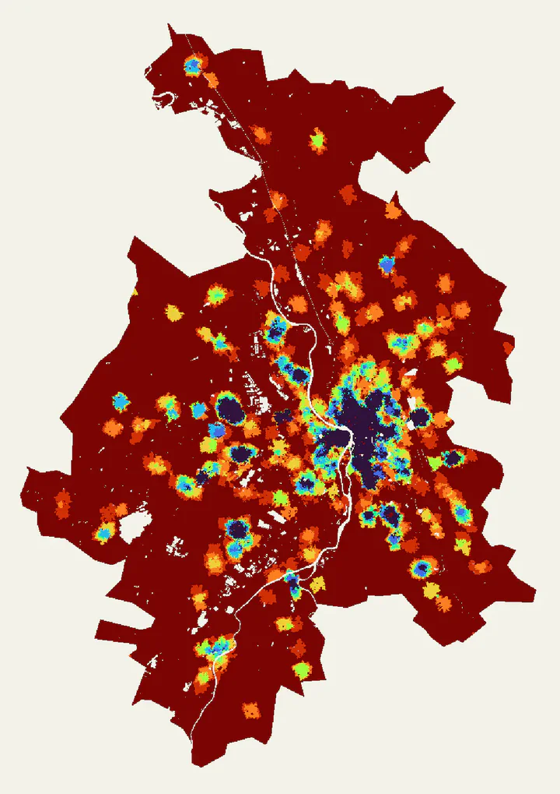 | 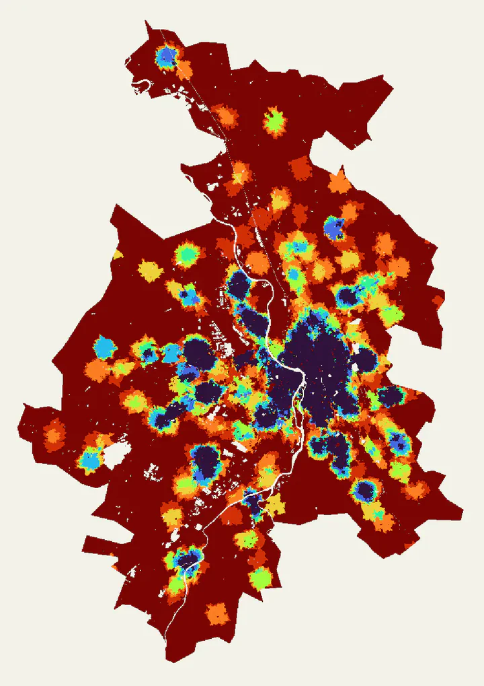 |

 0 ·  2 ·  4 ·  6 ·  ≥ 8

PDF A3 · [5 min](accessiviz-assets/print-maps/sante-nombre-de-lieux-a-5-minutes-a-pied.pdf?raw=true) · [10 min](accessiviz-assets/print-maps/sante-nombre-de-lieux-a-10-minutes-a-pied.pdf?raw=true) · [15 min](accessiviz-assets/print-maps/sante-nombre-de-lieux-a-15-minutes-a-pied.pdf?raw=true)

PNG 50 m · [5 min](accessiviz-assets/raster-maps/sante-nombre-de-lieux-a-5-minutes-a-pied.png?raw=true) · [10 min](accessiviz-assets/raster-maps/sante-nombre-de-lieux-a-10-minutes-a-pied.png?raw=true) · [15 min](accessiviz-assets/raster-maps/sante-nombre-de-lieux-a-15-minutes-a-pied.png?raw=true)

Nombre de lieux distincts de cette catégorie dans le temps de marche choisi. Zéro signifie qu’aucun lieu n’est atteint.

#### Points · Santé

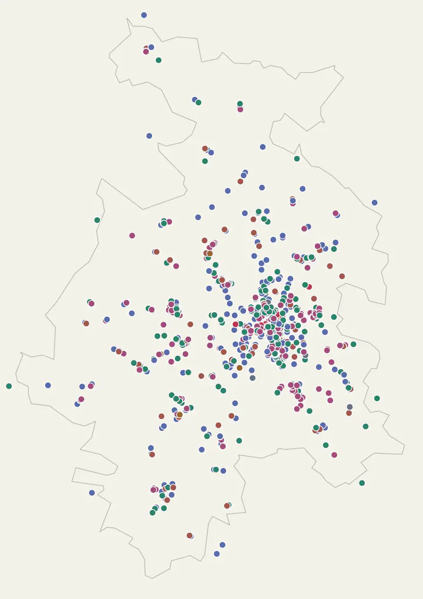

Emprise complète

[PDF A3](accessiviz-assets/print-maps/sante-lieux-representes-par-des-points.pdf?raw=true)

Lieux cartographiés comme points et colorés par sous-type.

#### Surfaces · Santé

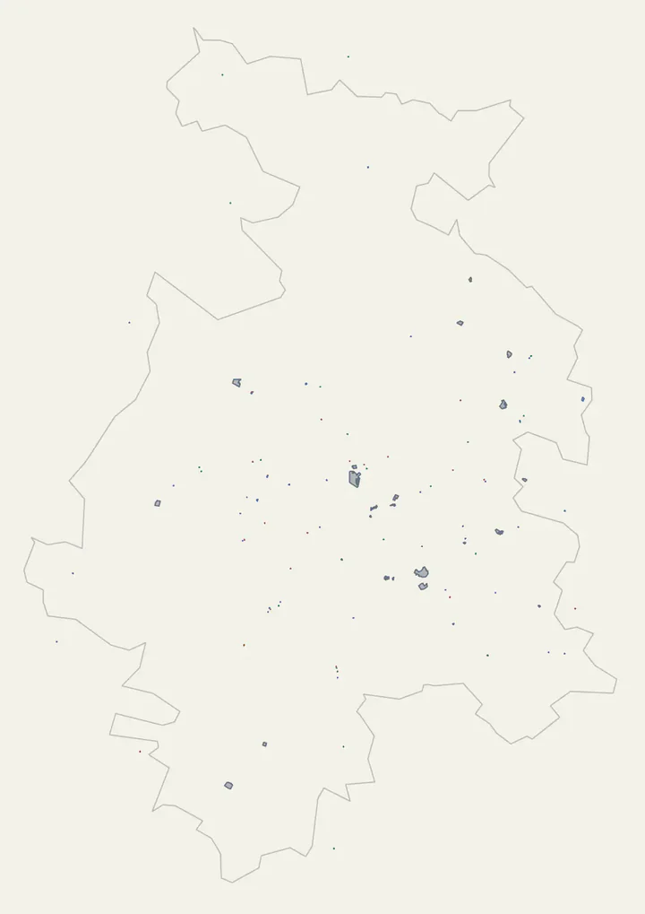

Emprise complète

[PDF A3](accessiviz-assets/print-maps/sante-emprises-des-lieux.pdf?raw=true)

Emprises cartographiées et colorées par sous-type.

Éducation

#### Temps minimum · Éducation · Marche

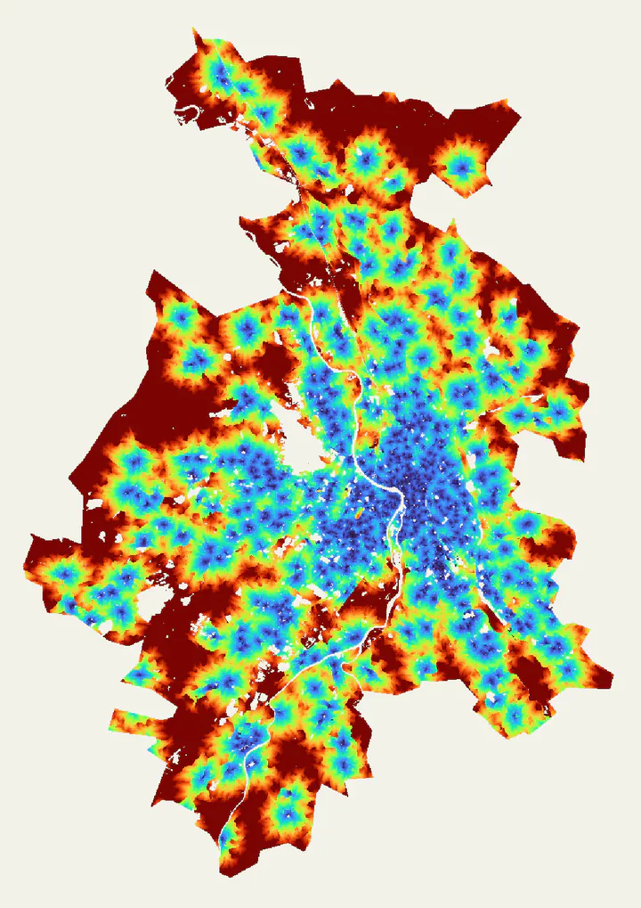

Marche

 0 ·  7,5 ·  15 ·  22,5 ·  ≥ 30 min

[PDF A3](accessiviz-assets/print-maps/education-temps-a-pied-jusquau-lieu-le-plus-proche.pdf?raw=true) · [PNG 50 m](accessiviz-assets/raster-maps/education-temps-a-pied-jusquau-lieu-le-plus-proche.png?raw=true)

Écoles, crèches éligibles, collèges, lycées, universités et bibliothèques. Les bibliothèques peuvent aussi compter en Culture.

#### Temps minimum · Éducation · Transports sans attente

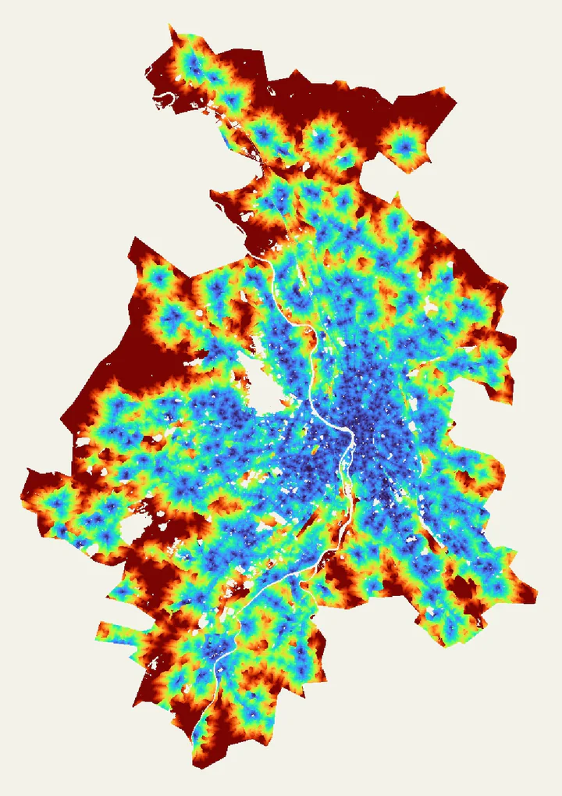

Marche + transports sans attente

 0 ·  7,5 ·  15 ·  22,5 ·  ≥ 30 min

[PDF A3](accessiviz-assets/print-maps/education-temps-jusquau-lieu-le-plus-proche-en-transports-sans-attente.pdf?raw=true) · [PNG 50 m](accessiviz-assets/raster-maps/education-temps-jusquau-lieu-le-plus-proche-en-transports-sans-attente.png?raw=true)

Trajet le plus rapide dans cette catégorie avec montée immédiate.

#### Nombre de lieux · Éducation

| Marche · 5 min | Marche · 10 min | Marche · 15 min |
|----|----|----|
|  | 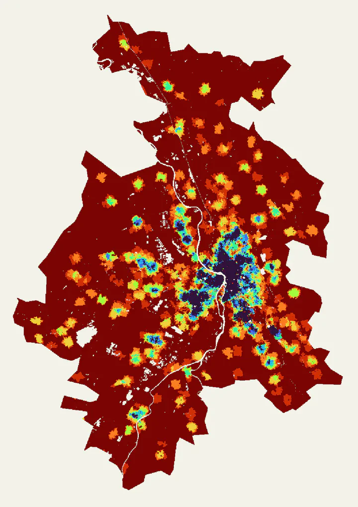 | 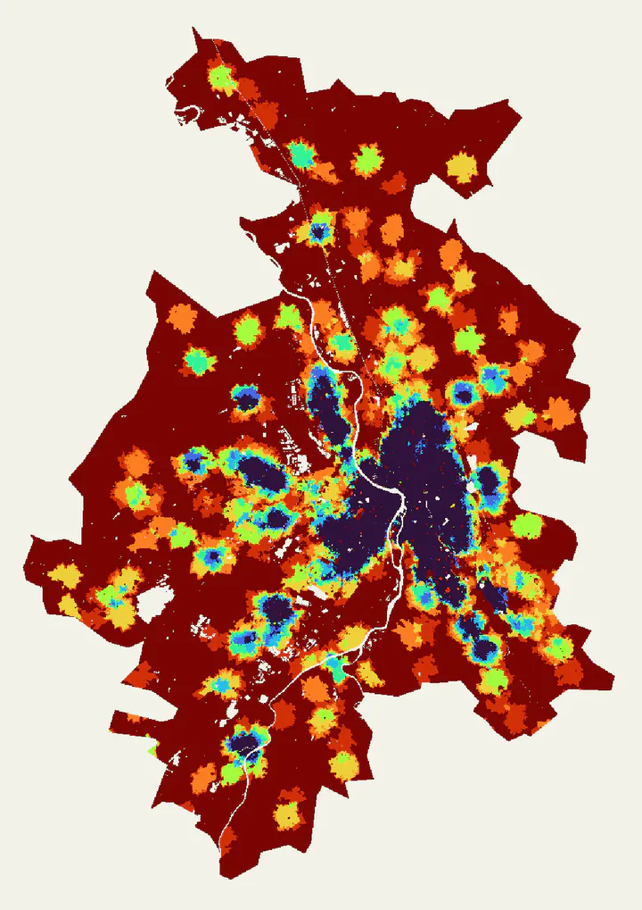 |

 0 ·  2 ·  4 ·  6 ·  ≥ 8

PDF A3 · [5 min](accessiviz-assets/print-maps/education-nombre-de-lieux-a-5-minutes-a-pied.pdf?raw=true) · [10 min](accessiviz-assets/print-maps/education-nombre-de-lieux-a-10-minutes-a-pied.pdf?raw=true) · [15 min](accessiviz-assets/print-maps/education-nombre-de-lieux-a-15-minutes-a-pied.pdf?raw=true)

PNG 50 m · [5 min](accessiviz-assets/raster-maps/education-nombre-de-lieux-a-5-minutes-a-pied.png?raw=true) · [10 min](accessiviz-assets/raster-maps/education-nombre-de-lieux-a-10-minutes-a-pied.png?raw=true) · [15 min](accessiviz-assets/raster-maps/education-nombre-de-lieux-a-15-minutes-a-pied.png?raw=true)

Nombre de lieux distincts de cette catégorie dans le temps de marche choisi. Zéro signifie qu’aucun lieu n’est atteint.

#### Points · Éducation

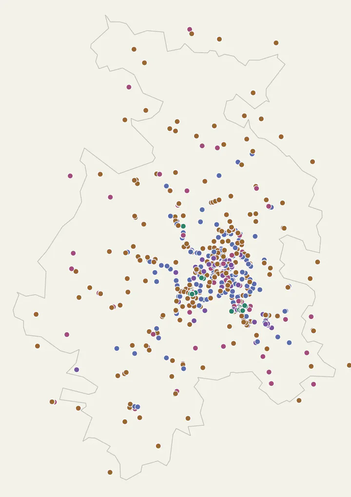

Emprise complète

[PDF A3](accessiviz-assets/print-maps/education-lieux-representes-par-des-points.pdf?raw=true)

Lieux cartographiés comme points et colorés par sous-type.

#### Surfaces · Éducation

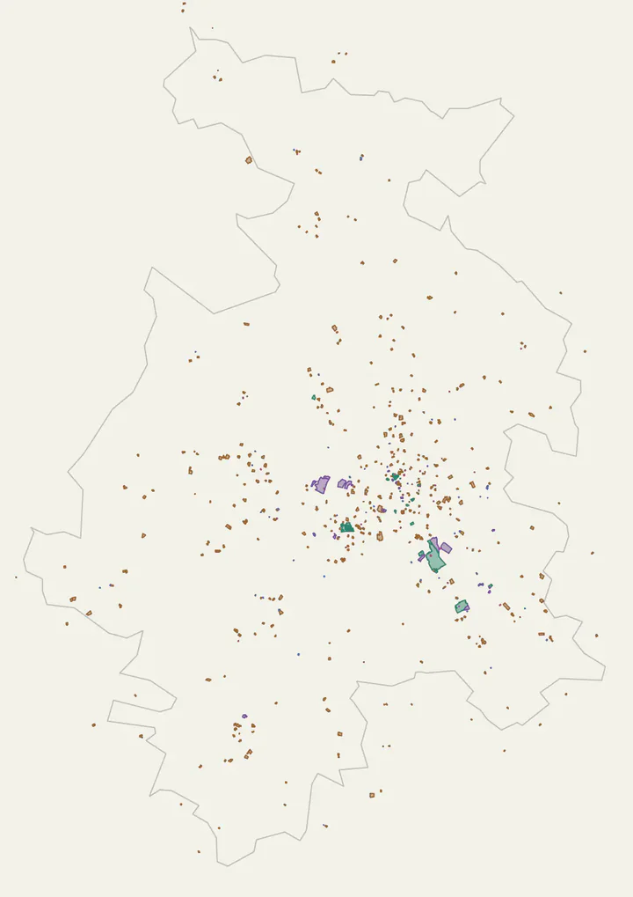

Emprise complète

[PDF A3](accessiviz-assets/print-maps/education-emprises-des-lieux.pdf?raw=true)

Emprises cartographiées et colorées par sous-type.

Loisirs

#### Temps minimum · Loisirs · Marche

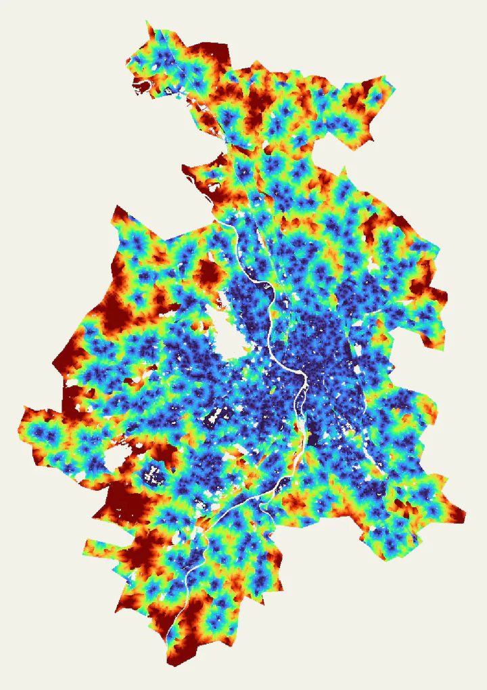

Marche

 0 ·  7,5 ·  15 ·  22,5 ·  ≥ 30 min

[PDF A3](accessiviz-assets/print-maps/loisirs-temps-a-pied-jusquau-lieu-le-plus-proche.pdf?raw=true) · [PNG 50 m](accessiviz-assets/raster-maps/loisirs-temps-a-pied-jusquau-lieu-le-plus-proche.png?raw=true)

Sports, jeux, piscines publiques, places, parcs et autres lieux de loisirs. Certains parcs comptent aussi en Nature. Les équipements scolaires exigent un accès public cartographié.

#### Temps minimum · Loisirs · Transports sans attente

Marche + transports sans attente

 0 ·  7,5 ·  15 ·  22,5 ·  ≥ 30 min

[PDF A3](accessiviz-assets/print-maps/loisirs-temps-jusquau-lieu-le-plus-proche-en-transports-sans-attente.pdf?raw=true) · [PNG 50 m](accessiviz-assets/raster-maps/loisirs-temps-jusquau-lieu-le-plus-proche-en-transports-sans-attente.png?raw=true)

Trajet le plus rapide dans cette catégorie avec montée immédiate.

#### Nombre de lieux · Loisirs

| Marche · 5 min | Marche · 10 min | Marche · 15 min |
|----|----|----|
|  |  |  |

 0 ·  2 ·  4 ·  6 ·  ≥ 8

PDF A3 · [5 min](accessiviz-assets/print-maps/loisirs-nombre-de-lieux-a-5-minutes-a-pied.pdf?raw=true) · [10 min](accessiviz-assets/print-maps/loisirs-nombre-de-lieux-a-10-minutes-a-pied.pdf?raw=true) · [15 min](accessiviz-assets/print-maps/loisirs-nombre-de-lieux-a-15-minutes-a-pied.pdf?raw=true)

PNG 50 m · [5 min](accessiviz-assets/raster-maps/loisirs-nombre-de-lieux-a-5-minutes-a-pied.png?raw=true) · [10 min](accessiviz-assets/raster-maps/loisirs-nombre-de-lieux-a-10-minutes-a-pied.png?raw=true) · [15 min](accessiviz-assets/raster-maps/loisirs-nombre-de-lieux-a-15-minutes-a-pied.png?raw=true)

Nombre de lieux distincts de cette catégorie dans le temps de marche choisi. Zéro signifie qu’aucun lieu n’est atteint.

#### Points · Loisirs

Emprise complète

[PDF A3](accessiviz-assets/print-maps/loisirs-lieux-representes-par-des-points.pdf?raw=true)

Lieux cartographiés comme points et colorés par sous-type.

#### Surfaces · Loisirs

Emprise complète

[PDF A3](accessiviz-assets/print-maps/loisirs-emprises-des-lieux.pdf?raw=true)

Emprises cartographiées et colorées par sous-type.

Restauration

#### Temps minimum · Restauration · Marche

Marche

 0 ·  7,5 ·  15 ·  22,5 ·  ≥ 30 min

[PDF A3](accessiviz-assets/print-maps/restauration-temps-a-pied-jusquau-lieu-le-plus-proche.pdf?raw=true) · [PNG 50 m](accessiviz-assets/raster-maps/restauration-temps-a-pied-jusquau-lieu-le-plus-proche.png?raw=true)

Restaurants, cafés, bars, restauration à emporter et établissements analogues.

#### Temps minimum · Restauration · Transports sans attente

Marche + transports sans attente

 0 ·  7,5 ·  15 ·  22,5 ·  ≥ 30 min

[PDF A3](accessiviz-assets/print-maps/restauration-temps-jusquau-lieu-le-plus-proche-en-transports-sans-attente.pdf?raw=true) · [PNG 50 m](accessiviz-assets/raster-maps/restauration-temps-jusquau-lieu-le-plus-proche-en-transports-sans-attente.png?raw=true)

Trajet le plus rapide dans cette catégorie avec montée immédiate.

#### Nombre de lieux · Restauration

| Marche · 5 min | Marche · 10 min | Marche · 15 min |
|----|----|----|
|  |  |  |

 0 ·  2 ·  4 ·  6 ·  ≥ 8

PDF A3 · [5 min](accessiviz-assets/print-maps/restauration-nombre-de-lieux-a-5-minutes-a-pied.pdf?raw=true) · [10 min](accessiviz-assets/print-maps/restauration-nombre-de-lieux-a-10-minutes-a-pied.pdf?raw=true) · [15 min](accessiviz-assets/print-maps/restauration-nombre-de-lieux-a-15-minutes-a-pied.pdf?raw=true)

PNG 50 m · [5 min](accessiviz-assets/raster-maps/restauration-nombre-de-lieux-a-5-minutes-a-pied.png?raw=true) · [10 min](accessiviz-assets/raster-maps/restauration-nombre-de-lieux-a-10-minutes-a-pied.png?raw=true) · [15 min](accessiviz-assets/raster-maps/restauration-nombre-de-lieux-a-15-minutes-a-pied.png?raw=true)

Nombre de lieux distincts de cette catégorie dans le temps de marche choisi. Zéro signifie qu’aucun lieu n’est atteint.

#### Points · Restauration

Emprise complète

[PDF A3](accessiviz-assets/print-maps/restauration-lieux-representes-par-des-points.pdf?raw=true)

Lieux cartographiés comme points et colorés par sous-type.

#### Surfaces · Restauration

Emprise complète

[PDF A3](accessiviz-assets/print-maps/restauration-emprises-des-lieux.pdf?raw=true)

Emprises cartographiées et colorées par sous-type.

Commerces et services

#### Temps minimum · Commerces et services · Marche

Marche

 0 ·  7,5 ·  15 ·  22,5 ·  ≥ 30 min

[PDF A3](accessiviz-assets/print-maps/commerces-et-services-temps-a-pied-jusquau-lieu-le-plus-proche.pdf?raw=true) · [PNG 50 m](accessiviz-assets/raster-maps/commerces-et-services-temps-a-pied-jusquau-lieu-le-plus-proche.png?raw=true)

Commerces hors alimentation et services enregistrés comme commerces, comme les salons de coiffure.

#### Temps minimum · Commerces et services · Transports sans attente

Marche + transports sans attente

 0 ·  7,5 ·  15 ·  22,5 ·  ≥ 30 min

[PDF A3](accessiviz-assets/print-maps/commerces-et-services-temps-jusquau-lieu-le-plus-proche-en-transports-sans-attente.pdf?raw=true) · [PNG 50 m](accessiviz-assets/raster-maps/commerces-et-services-temps-jusquau-lieu-le-plus-proche-en-transports-sans-attente.png?raw=true)

Trajet le plus rapide dans cette catégorie avec montée immédiate.

#### Nombre de lieux · Commerces et services

| Marche · 5 min | Marche · 10 min | Marche · 15 min |
|----|----|----|
|  |  |  |

 0 ·  2 ·  4 ·  6 ·  ≥ 8

PDF A3 · [5 min](accessiviz-assets/print-maps/commerces-et-services-nombre-de-lieux-a-5-minutes-a-pied.pdf?raw=true) · [10 min](accessiviz-assets/print-maps/commerces-et-services-nombre-de-lieux-a-10-minutes-a-pied.pdf?raw=true) · [15 min](accessiviz-assets/print-maps/commerces-et-services-nombre-de-lieux-a-15-minutes-a-pied.pdf?raw=true)

PNG 50 m · [5 min](accessiviz-assets/raster-maps/commerces-et-services-nombre-de-lieux-a-5-minutes-a-pied.png?raw=true) · [10 min](accessiviz-assets/raster-maps/commerces-et-services-nombre-de-lieux-a-10-minutes-a-pied.png?raw=true) · [15 min](accessiviz-assets/raster-maps/commerces-et-services-nombre-de-lieux-a-15-minutes-a-pied.png?raw=true)

Nombre de lieux distincts de cette catégorie dans le temps de marche choisi. Zéro signifie qu’aucun lieu n’est atteint.

#### Points · Commerces et services

Emprise complète

[PDF A3](accessiviz-assets/print-maps/commerces-et-services-lieux-representes-par-des-points.pdf?raw=true)

Lieux cartographiés comme points et colorés par sous-type.

#### Surfaces · Commerces et services

Emprise complète

[PDF A3](accessiviz-assets/print-maps/commerces-et-services-emprises-des-lieux.pdf?raw=true)

Emprises cartographiées et colorées par sous-type.

Services civiques

#### Temps minimum · Services civiques · Marche

Marche

 0 ·  7,5 ·  15 ·  22,5 ·  ≥ 30 min

[PDF A3](accessiviz-assets/print-maps/services-civiques-temps-a-pied-jusquau-lieu-le-plus-proche.pdf?raw=true) · [PNG 50 m](accessiviz-assets/raster-maps/services-civiques-temps-a-pied-jusquau-lieu-le-plus-proche.png?raw=true)

Mairies, bureaux de poste, centres sociaux, banques, lieux de culte et services de secours cartographiés.

#### Temps minimum · Services civiques · Transports sans attente

Marche + transports sans attente

 0 ·  7,5 ·  15 ·  22,5 ·  ≥ 30 min

[PDF A3](accessiviz-assets/print-maps/services-civiques-temps-jusquau-lieu-le-plus-proche-en-transports-sans-attente.pdf?raw=true) · [PNG 50 m](accessiviz-assets/raster-maps/services-civiques-temps-jusquau-lieu-le-plus-proche-en-transports-sans-attente.png?raw=true)

Trajet le plus rapide dans cette catégorie avec montée immédiate.

#### Nombre de lieux · Services civiques

| Marche · 5 min | Marche · 10 min | Marche · 15 min |
|----|----|----|
|  |  |  |

 0 ·  2 ·  4 ·  6 ·  ≥ 8

PDF A3 · [5 min](accessiviz-assets/print-maps/services-civiques-nombre-de-lieux-a-5-minutes-a-pied.pdf?raw=true) · [10 min](accessiviz-assets/print-maps/services-civiques-nombre-de-lieux-a-10-minutes-a-pied.pdf?raw=true) · [15 min](accessiviz-assets/print-maps/services-civiques-nombre-de-lieux-a-15-minutes-a-pied.pdf?raw=true)

PNG 50 m · [5 min](accessiviz-assets/raster-maps/services-civiques-nombre-de-lieux-a-5-minutes-a-pied.png?raw=true) · [10 min](accessiviz-assets/raster-maps/services-civiques-nombre-de-lieux-a-10-minutes-a-pied.png?raw=true) · [15 min](accessiviz-assets/raster-maps/services-civiques-nombre-de-lieux-a-15-minutes-a-pied.png?raw=true)

Nombre de lieux distincts de cette catégorie dans le temps de marche choisi. Zéro signifie qu’aucun lieu n’est atteint.

#### Points · Services civiques

Emprise complète

[PDF A3](accessiviz-assets/print-maps/services-civiques-lieux-representes-par-des-points.pdf?raw=true)

Lieux cartographiés comme points et colorés par sous-type.

#### Surfaces · Services civiques

Emprise complète

[PDF A3](accessiviz-assets/print-maps/services-civiques-emprises-des-lieux.pdf?raw=true)

Emprises cartographiées et colorées par sous-type.

Nature

#### Temps minimum · Nature · Marche

Marche

 0 ·  7,5 ·  15 ·  22,5 ·  ≥ 30 min

[PDF A3](accessiviz-assets/print-maps/nature-temps-a-pied-jusquau-lieu-le-plus-proche.pdf?raw=true) · [PNG 50 m](accessiviz-assets/raster-maps/nature-temps-a-pied-jusquau-lieu-le-plus-proche.png?raw=true)

Parcs, bois, forêts, réserves et plans d’eau accessibles depuis une rive. Parmi les jardins admissibles, on retient les jardins nommés, botaniques, ou explicitement publics d’au moins 5 000 m². Les jardins privés ou résidentiels sont exclus.

#### Temps minimum · Nature · Transports sans attente

Marche + transports sans attente

 0 ·  7,5 ·  15 ·  22,5 ·  ≥ 30 min

[PDF A3](accessiviz-assets/print-maps/nature-temps-jusquau-lieu-le-plus-proche-en-transports-sans-attente.pdf?raw=true) · [PNG 50 m](accessiviz-assets/raster-maps/nature-temps-jusquau-lieu-le-plus-proche-en-transports-sans-attente.png?raw=true)

Trajet le plus rapide dans cette catégorie avec montée immédiate.

#### Nombre de lieux · Nature

| Marche · 5 min | Marche · 10 min | Marche · 15 min |
|----|----|----|
|  |  |  |

 0 ·  2 ·  4 ·  6 ·  ≥ 8

PDF A3 · [5 min](accessiviz-assets/print-maps/nature-nombre-de-lieux-a-5-minutes-a-pied.pdf?raw=true) · [10 min](accessiviz-assets/print-maps/nature-nombre-de-lieux-a-10-minutes-a-pied.pdf?raw=true) · [15 min](accessiviz-assets/print-maps/nature-nombre-de-lieux-a-15-minutes-a-pied.pdf?raw=true)

PNG 50 m · [5 min](accessiviz-assets/raster-maps/nature-nombre-de-lieux-a-5-minutes-a-pied.png?raw=true) · [10 min](accessiviz-assets/raster-maps/nature-nombre-de-lieux-a-10-minutes-a-pied.png?raw=true) · [15 min](accessiviz-assets/raster-maps/nature-nombre-de-lieux-a-15-minutes-a-pied.png?raw=true)

Nombre de lieux distincts de cette catégorie dans le temps de marche choisi. Zéro signifie qu’aucun lieu n’est atteint.

#### Points · Nature

Emprise complète

[PDF A3](accessiviz-assets/print-maps/nature-lieux-representes-par-des-points.pdf?raw=true)

Lieux cartographiés comme points et colorés par sous-type.

#### Surfaces · Nature

Emprise complète

[PDF A3](accessiviz-assets/print-maps/nature-emprises-des-lieux.pdf?raw=true)

Emprises cartographiées et colorées par sous-type. Les destinations en eau sont accessibles par une rive.

Culture

#### Temps minimum · Culture · Marche

Marche

 0 ·  7,5 ·  15 ·  22,5 ·  ≥ 30 min

[PDF A3](accessiviz-assets/print-maps/culture-temps-a-pied-jusquau-lieu-le-plus-proche.pdf?raw=true) · [PNG 50 m](accessiviz-assets/raster-maps/culture-temps-a-pied-jusquau-lieu-le-plus-proche.png?raw=true)

Bibliothèques, musées, cinémas, théâtres, centres d’art et salles de spectacle. Certains lieux appartiennent aussi à Éducation ou Loisirs.

#### Temps minimum · Culture · Transports sans attente

Marche + transports sans attente

 0 ·  7,5 ·  15 ·  22,5 ·  ≥ 30 min

[PDF A3](accessiviz-assets/print-maps/culture-temps-jusquau-lieu-le-plus-proche-en-transports-sans-attente.pdf?raw=true) · [PNG 50 m](accessiviz-assets/raster-maps/culture-temps-jusquau-lieu-le-plus-proche-en-transports-sans-attente.png?raw=true)

Trajet le plus rapide dans cette catégorie avec montée immédiate.

#### Nombre de lieux · Culture

| Marche · 5 min | Marche · 10 min | Marche · 15 min |
|----|----|----|
|  |  |  |

 0 ·  2 ·  4 ·  6 ·  ≥ 8

PDF A3 · [5 min](accessiviz-assets/print-maps/culture-nombre-de-lieux-a-5-minutes-a-pied.pdf?raw=true) · [10 min](accessiviz-assets/print-maps/culture-nombre-de-lieux-a-10-minutes-a-pied.pdf?raw=true) · [15 min](accessiviz-assets/print-maps/culture-nombre-de-lieux-a-15-minutes-a-pied.pdf?raw=true)

PNG 50 m · [5 min](accessiviz-assets/raster-maps/culture-nombre-de-lieux-a-5-minutes-a-pied.png?raw=true) · [10 min](accessiviz-assets/raster-maps/culture-nombre-de-lieux-a-10-minutes-a-pied.png?raw=true) · [15 min](accessiviz-assets/raster-maps/culture-nombre-de-lieux-a-15-minutes-a-pied.png?raw=true)

Nombre de lieux distincts de cette catégorie dans le temps de marche choisi. Zéro signifie qu’aucun lieu n’est atteint.

#### Points · Culture

Emprise complète

[PDF A3](accessiviz-assets/print-maps/culture-lieux-representes-par-des-points.pdf?raw=true)

Lieux cartographiés comme points et colorés par sous-type.

#### Surfaces · Culture

Emprise complète

[PDF A3](accessiviz-assets/print-maps/culture-emprises-des-lieux.pdf?raw=true)

Emprises cartographiées et colorées par sous-type.

Qualité des mailles

Ces cartes indiquent où commencent les trajets et aident à comprendre pourquoi certaines mailles sont vides.

### État de la maille

Marche · emprise complète

 Calculée ·  Non échantillonnée ·  Échec ·  En attente

[PDF A3](accessiviz-assets/print-maps/etat-de-la-maille-mailles-de-depart-a-pied.pdf?raw=true) · [PNG 50 m](accessiviz-assets/raster-maps/etat-de-la-maille-mailles-de-depart-a-pied.png?raw=true)

Consultez cette couche pour savoir si une maille est calculée, non échantillonnée, en attente ou en échec. Une maille calculée peut encore être dépourvue d’itinéraire pour une catégorie.

### Méthode d’échantillonnage

Marche · emprise complète

 Non échantillonnée ·  Point du réseau ·  Liaison depuis le centre ·  Inconnu

[PDF A3](accessiviz-assets/print-maps/methode-dechantillonnage-mailles-de-depart-a-pied.pdf?raw=true) · [PNG 50 m](accessiviz-assets/raster-maps/methode-dechantillonnage-mailles-de-depart-a-pied.png?raw=true)

Le départ peut se situer sur le réseau ou à l’intérieur de la maille. Dans ce second cas, le modèle estime le temps nécessaire pour rejoindre le réseau.

### Indicateurs de qualité

Marche · valeurs numériques

[PDF A3](accessiviz-assets/print-maps/indicateurs-de-qualite-mailles-de-depart-a-pied.pdf?raw=true) · [PNG 50 m](accessiviz-assets/raster-maps/indicateurs-de-qualite-mailles-de-depart-a-pied.png?raw=true)

Ces codes décrivent les hypothèses utilisées pour le départ, par exemple une sortie de bâtiment ou le passage par un portail. Plusieurs codes peuvent s’appliquer à une même maille. Utilisez Identifier les entités et le manifeste pour lire le masque de bits.

### Borne inférieure du temps toutes catégories

Marche · indicateur de borne

 Observé ·  Borne inférieure

[PDF A3](accessiviz-assets/print-maps/borne-inferieure-du-temps-toutes-categories-mailles-de-depart-a-pied.pdf?raw=true) · [PNG 50 m](accessiviz-assets/raster-maps/borne-inferieure-du-temps-toutes-categories-mailles-de-depart-a-pied.png?raw=true)

Dans les calculs plus anciens, une valeur de 1 indique un temps minimum estimé faute de trajet exact dans l’horizon de recherche. Zéro indique qu’aucune borne n’a été substituée. Consultez aussi la couche de temps.

### Borne inférieure du rapport maximal

Marche · indicateur de borne

 Observé ·  Borne inférieure

[PDF A3](accessiviz-assets/print-maps/borne-inferieure-du-rapport-maximal-mailles-de-depart-a-pied.pdf?raw=true) · [PNG 50 m](accessiviz-assets/raster-maps/borne-inferieure-du-rapport-maximal-mailles-de-depart-a-pied.png?raw=true)

Une valeur de 1 indique que le rapport maximal publié est une borne inférieure. Zéro indique qu’aucune borne n’a été substituée. Le rapport peut rester inconnu.

### Décalage du point de départ (m)

Marche · emprise complète

 0 ·  100

[PDF A3](accessiviz-assets/print-maps/decalage-du-point-de-depart-mailles-de-depart-a-pied.pdf?raw=true) · [PNG 50 m](accessiviz-assets/raster-maps/decalage-du-point-de-depart-mailles-de-depart-a-pied.png?raw=true)

Distance en ligne droite entre le centre de la maille et le point retenu. Une maille coupée par le contour de l’étude peut utiliser un point décalé.

### Longueur de la liaison estimée (m)

Marche · emprise complète

 0 ·  100

[PDF A3](accessiviz-assets/print-maps/longueur-de-la-liaison-estimee-mailles-de-depart-a-pied.pdf?raw=true) · [PNG 50 m](accessiviz-assets/raster-maps/longueur-de-la-liaison-estimee-mailles-de-depart-a-pied.png?raw=true)

Distance entre le point échantillonné et le réseau piéton. Un départ sur le réseau vaut zéro. Les segments intérieurs ou en eau admissibles sont parcourus à vitesse réduite.

### Part de la maille dans le périmètre

Marche · emprise complète

 0 ·  1

[PDF A3](accessiviz-assets/print-maps/part-de-la-maille-dans-le-perimetre-mailles-de-depart-a-pied.pdf?raw=true) · [PNG 50 m](accessiviz-assets/raster-maps/part-de-la-maille-dans-le-perimetre-mailles-de-depart-a-pied.png?raw=true)

Part de la maille comprise dans la zone d’étude. La valeur 1 signifie que toute la maille est incluse et 0,4 que 40 % le sont. Cette valeur peut servir à pondérer les mailles de bordure.

Couches de contexte et tableaux

### Périmètre d’étude

Toulouse et alentours

[PDF A3](accessiviz-assets/print-maps/perimetre-detude.pdf?raw=true)

Contour de la zone dans laquelle les mailles sont publiées. Un trajet peut emprunter un chemin ou atteindre une destination hors du périmètre.

### Rues et chemins

Emprise complète

[PDF A3](accessiviz-assets/print-maps/rues-et-chemins.pdf?raw=true)

Réseau cartographié de rues et de chemins. Dans QGIS, zoomez au 1:40 000 ou à une échelle plus détaillée.

### Cours d’eau et canaux

Lignes hydrographiques

[PDF A3](accessiviz-assets/print-maps/cours-deau-et-canaux.pdf?raw=true)

Axes des cours d’eau, y compris les ruisseaux trop étroits pour être représentés par une surface.

### Surfaces en eau

Polygones hydrographiques

[PDF A3](accessiviz-assets/print-maps/surfaces-en-eau.pdf?raw=true)

Emprises cartographiées des lacs, rivières, étangs, bassins et piscines.

### Lignes de transport en commun

Réseau Tisséo

[PDF A3](accessiviz-assets/print-maps/lignes-de-transport-en-commun-reseau-tisseo.pdf?raw=true)

Tracés des lignes Tisséo desservant les dates échantillonnées, avec les couleurs de l’opérateur. Les cartes sans attente permettent de comparer l’accès avec la marche seule.

### Arrêts voyageurs

Emprise complète

[PDF A3](accessiviz-assets/print-maps/arrets-voyageurs-reseau-tisseo.pdf?raw=true)

Points de montée et de descente. Dans QGIS, zoomez au 1:25 000 ou à une échelle plus détaillée.

Définition des catégories 14 catégories et préréglages

Consultez les critères de sélection, les recoupements et les catégories utilisées dans le projet. [CSV](accessiviz-assets/category-guide.csv)

| Catégorie | Utilisée ici | Lieux retenus | Règles OpenStreetMap | Limites et recoupements | Nombre de référence (choix) |
|----|----|----|----|----|----|
| Alimentation | Oui | Commerces alimentaires et marchés, dont les supermarchés, supérettes, primeurs et boulangeries. | amenity=marketplace OR shop=supermarket\|convenience\|grocery\|greengrocer\|bakery\|butcher\|deli\|food\|farm\|seafood | Les commerces alimentaires sont exclus de Commerces et services. | 4 |
| Santé | Oui | Pharmacies, cliniques, hôpitaux, cabinets médicaux, dentistes et autres professionnels de santé. | amenity=pharmacy\|hospital\|clinic\|doctors\|dentist OR healthcare=hospital\|clinic\|doctor\|dentist\|physiotherapist\|laboratory\|centre | — | 6 |
| Éducation | Oui | Écoles, crèches éligibles, collèges, lycées, universités et bibliothèques. Les bibliothèques peuvent aussi compter en Culture. | amenity=school\|kindergarten\|college\|university\|library | Les bibliothèques comptent aussi en Culture. | 4 |
| Loisirs | Oui | Sports, jeux, piscines publiques, places, parcs et autres lieux de loisirs. Certains parcs comptent aussi en Nature. Les équipements scolaires exigent un accès public cartographié. | leisure=park\|garden\|playground\|sports_centre\|fitness_centre\|pitch\|swimming_pool OR place=square OR amenity=cinema\|theatre\|arts_centre | Certains parcs et jardins admissibles comptent aussi en Nature. Les cinémas et salles de spectacle peuvent aussi compter en Culture. | 5 |
| Restauration | Oui | Restaurants, cafés, bars, restauration à emporter et établissements analogues. | amenity=restaurant\|cafe\|fast_food\|food_court\|bar\|pub\|ice_cream | Un lieu peut appartenir à la fois à Alimentation et à Restauration. | 15 |
| Commerces et services | Oui | Commerces hors alimentation et services enregistrés comme commerces, comme les salons de coiffure. | shop=\* except no\|vacant\|yes; no Groceries membership | — | 8 |
| Services civiques | Oui | Mairies, bureaux de poste, centres sociaux, banques, lieux de culte et services de secours cartographiés. | amenity=post_office\|townhall\|community_centre\|social_centre\|bank\|police\|fire_station\|place_of_worship | — | 4 |
| Nature | Oui | Parcs, bois, forêts, réserves et plans d’eau accessibles depuis une rive. Parmi les jardins admissibles, on retient les jardins nommés, botaniques, ou explicitement publics d’au moins 5 000 m². Les jardins privés ou résidentiels sont exclus. | leisure=park\|garden (see eligibility)\|nature_reserve OR natural=wood\|water (areas only for water) OR landuse=forest OR waterway=riverbank (areas only) | Les destinations en eau sont accessibles depuis une rive. Un jardin peut rester en Loisirs après son exclusion de Nature. | 3 |
| Culture | Oui | Bibliothèques, musées, cinémas, théâtres, centres d’art et salles de spectacle. Certains lieux appartiennent aussi à Éducation ou Loisirs. | amenity=library\|cinema\|theatre\|arts_centre\|concert_hall\|music_venue OR tourism=museum | Les bibliothèques, cinémas et salles de spectacle peuvent appartenir à plusieurs catégories. | 5 |
| Arrêts et stations voyageurs | Non | Arrêts et stations utilisés comme destinations. | highway=bus_stop OR amenity=bus_station OR public_transport=platform\|station AND bus=yes OR railway=station\|halt AND (station=subway OR subway=yes) OR public_transport=platform\|station AND subway=yes OR railway=tram_stop OR public_transport=platform\|station AND tram=yes OR railway=station\|halt AND no bus\|tram\|metro mode match OR public_transport=platform\|station AND train=yes | — | — |
| Arrêts de bus | Non | Arrêts et stations utilisés comme destinations. | highway=bus_stop OR amenity=bus_station OR public_transport=platform\|station AND bus=yes | — | — |
| Stations de métro | Non | Arrêts et stations utilisés comme destinations. | railway=station\|halt AND (station=subway OR subway=yes) OR public_transport=platform\|station AND subway=yes | — | — |
| Arrêts de tram | Non | Arrêts et stations utilisés comme destinations. | railway=tram_stop OR public_transport=platform\|station AND tram=yes | — | — |
| Gares ferroviaires | Non | Arrêts et stations utilisés comme destinations. | railway=station\|halt AND no bus\|tram\|metro mode match OR public_transport=platform\|station AND train=yes | — | — |

Définition des catégories

Inventaire par catégorie et sous-type 311 lignes

Comparez les nombres de lieux cartographiés et de lieux dotés de points d’accès au réseau. [CSV](accessiviz-assets/category-inventory.csv)

| Catégorie | Sous-type OSM | Destinations | Avec points d’accès |
|----|----|----|----|
| Services civiques | bank | 344 | 342 |
| Services civiques | community_centre | 243 | 237 |
| Services civiques | fire_station | 12 | 12 |
| Services civiques | place_of_worship | 260 | 252 |
| Services civiques | police | 56 | 41 |
| Services civiques | post_office | 132 | 128 |
| Services civiques | social_centre | 24 | 23 |
| Services civiques | townhall | 138 | 138 |
| Culture | arts_centre | 37 | 35 |
| Culture | cinema | 34 | 33 |
| Culture | concert_hall | 1 | 1 |
| Culture | garden | 1 | 1 |
| Culture | library | 96 | 94 |
| Culture | museum | 29 | 27 |
| Culture | music_venue | 2 | 2 |
| Culture | place_of_worship | 1 | 1 |
| Culture | theatre | 68 | 66 |
| Restauration | bar | 249 | 244 |
| Restauration | cafe | 259 | 256 |
| Restauration | fast_food | 730 | 722 |
| Restauration | food_court | 9 | 8 |
| Restauration | ice_cream | 22 | 22 |
| Restauration | pub | 66 | 64 |
| Restauration | restaurant | 1487 | 1461 |
| Éducation | college | 107 | 102 |
| Éducation | kindergarten | 199 | 193 |
| Éducation | library | 96 | 94 |
| Éducation | school | 826 | 764 |
| Éducation | university | 124 | 119 |
| Alimentation | bakery | 402 | 400 |
| Alimentation | butcher | 209 | 209 |
| Alimentation | cafe | 3 | 3 |
| Alimentation | convenience | 355 | 349 |
| Alimentation | deli | 69 | 69 |
| Alimentation | farm | 15 | 15 |
| Alimentation | fast_food | 5 | 5 |
| Alimentation | food | 2 | 2 |
| Alimentation | fuel | 16 | 16 |
| Alimentation | greengrocer | 79 | 79 |
| Alimentation | grocery | 4 | 4 |
| Alimentation | marketplace | 104 | 103 |
| Alimentation | pub | 1 | 1 |
| Alimentation | restaurant | 6 | 6 |
| Alimentation | seafood | 30 | 29 |
| Alimentation | supermarket | 219 | 217 |
| Santé | centre | 17 | 17 |
| Santé | clinic | 44 | 40 |
| Santé | dentist | 210 | 206 |
| Santé | doctor | 8 | 7 |
| Santé | doctors | 305 | 300 |
| Santé | healthcare | 1 | 1 |
| Santé | hospital | 37 | 36 |
| Santé | laboratory | 96 | 94 |
| Santé | pharmacy | 324 | 321 |
| Santé | physiotherapist | 71 | 68 |
| Santé | social_facility | 1 | 1 |
| Nature | attraction | 1 | 1 |
| Nature | fishing | 1 | 1 |
| Nature | forest | 1159 | 1077 |
| Nature | fountain | 2 | 2 |
| Nature | garden | 42 | 40 |
| Nature | island | 1 | 1 |
| Nature | islet | 4 | 0 |
| Nature | marina | 1 | 1 |
| Nature | nature_reserve | 5 | 5 |
| Nature | park | 560 | 555 |
| Nature | scrub | 3 | 3 |
| Nature | water | 1837 | 1595 |
| Nature | wood | 2553 | 2318 |
| Loisirs | arts_centre | 37 | 35 |
| Loisirs | beauty | 1 | 1 |
| Loisirs | cafe | 1 | 1 |
| Loisirs | cinema | 34 | 33 |
| Loisirs | common | 1 | 1 |
| Loisirs | community_centre | 3 | 3 |
| Loisirs | dancing_school | 1 | 1 |
| Loisirs | doctors | 1 | 1 |
| Loisirs | dojo | 2 | 2 |
| Loisirs | fitness_centre | 123 | 118 |
| Loisirs | garden | 199 | 162 |
| Loisirs | park | 560 | 555 |
| Loisirs | parking | 1 | 1 |
| Loisirs | pitch | 2108 | 1992 |
| Loisirs | playground | 712 | 689 |
| Loisirs | sports_centre | 308 | 287 |
| Loisirs | square | 184 | 181 |
| Loisirs | swimming_pool | 156 | 3 |
| Loisirs | theatre | 68 | 66 |
| Commerces et services | agrarian | 2 | 2 |
| Commerces et services | airplane | 1 | 1 |
| Commerces et services | alcohol | 65 | 64 |
| Commerces et services | alcohol;butcher;cheese | 1 | 1 |
| Commerces et services | anime | 2 | 2 |
| Commerces et services | antiques | 18 | 18 |
| Commerces et services | apiary | 2 | 2 |
| Commerces et services | appliance | 8 | 8 |
| Commerces et services | art | 27 | 27 |
| Commerces et services | auction_house | 2 | 2 |
| Commerces et services | baby_goods | 10 | 10 |
| Commerces et services | baby_goods;clothes | 1 | 1 |
| Commerces et services | bag | 12 | 12 |
| Commerces et services | bakery;pastry | 1 | 1 |
| Commerces et services | bar | 9 | 9 |
| Commerces et services | bathroom_furnishing | 6 | 5 |
| Commerces et services | battery | 1 | 1 |
| Commerces et services | beauty | 246 | 245 |
| Commerces et services | bed | 18 | 18 |
| Commerces et services | beverages | 3 | 3 |
| Commerces et services | bicycle | 72 | 70 |
| Commerces et services | bicycle_rental | 4 | 4 |
| Commerces et services | bicycle_repair | 1 | 1 |
| Commerces et services | bookmaker | 3 | 3 |
| Commerces et services | books | 78 | 78 |
| Commerces et services | boutique | 2 | 2 |
| Commerces et services | building_materials | 1 | 1 |
| Commerces et services | bureau_de_change | 1 | 1 |
| Commerces et services | cafe | 14 | 14 |
| Commerces et services | camera | 2 | 2 |
| Commerces et services | candles | 3 | 3 |
| Commerces et services | cannabis | 21 | 21 |
| Commerces et services | car | 141 | 134 |
| Commerces et services | car_parts | 25 | 24 |
| Commerces et services | car_rental | 1 | 1 |
| Commerces et services | car_repair | 255 | 251 |
| Commerces et services | caravan | 8 | 8 |
| Commerces et services | carpet | 3 | 3 |
| Commerces et services | charity | 9 | 8 |
| Commerces et services | cheese | 40 | 40 |
| Commerces et services | chemist | 13 | 13 |
| Commerces et services | chocolate | 37 | 37 |
| Commerces et services | clothes | 631 | 626 |
| Commerces et services | clothes & accessories | 1 | 0 |
| Commerces et services | clothes;shoes | 2 | 2 |
| Commerces et services | coffee | 12 | 12 |
| Commerces et services | collector | 1 | 1 |
| Commerces et services | computer | 25 | 25 |
| Commerces et services | concept_store | 1 | 1 |
| Commerces et services | confectionery | 21 | 21 |
| Commerces et services | copyshop | 21 | 20 |
| Commerces et services | cosmetics | 68 | 68 |
| Commerces et services | country_store | 2 | 2 |
| Commerces et services | craft | 14 | 14 |
| Commerces et services | curtain | 2 | 2 |
| Commerces et services | dairy | 3 | 3 |
| Commerces et services | department_store | 3 | 3 |
| Commerces et services | doityourself | 82 | 81 |
| Commerces et services | doors | 2 | 2 |
| Commerces et services | dressmaker | 1 | 1 |
| Commerces et services | dry_cleaning | 46 | 46 |
| Commerces et services | e-cigarette | 54 | 54 |
| Commerces et services | electric_scooter | 1 | 1 |
| Commerces et services | electrical | 11 | 9 |
| Commerces et services | electronics | 30 | 30 |
| Commerces et services | ephemera | 1 | 1 |
| Commerces et services | erotic | 8 | 8 |
| Commerces et services | esoteric | 4 | 4 |
| Commerces et services | estate_agent | 6 | 6 |
| Commerces et services | fabric | 25 | 25 |
| Commerces et services | fashion_accessories | 15 | 14 |
| Commerces et services | fireplace | 8 | 8 |
| Commerces et services | fishing | 3 | 3 |
| Commerces et services | flooring | 3 | 3 |
| Commerces et services | flooring;bathroom_furnishing | 1 | 1 |
| Commerces et services | florist | 106 | 106 |
| Commerces et services | foot | 1 | 1 |
| Commerces et services | frame | 3 | 2 |
| Commerces et services | frozen_food | 35 | 35 |
| Commerces et services | fuel | 74 | 74 |
| Commerces et services | funeral_directors | 36 | 36 |
| Commerces et services | furniture | 77 | 77 |
| Commerces et services | gambling | 1 | 1 |
| Commerces et services | games | 11 | 11 |
| Commerces et services | garden_centre | 32 | 30 |
| Commerces et services | gas | 6 | 6 |
| Commerces et services | general | 9 | 8 |
| Commerces et services | gift | 35 | 33 |
| Commerces et services | gift;kiosk;sports | 1 | 1 |
| Commerces et services | glaziery | 4 | 4 |
| Commerces et services | gold | 4 | 4 |
| Commerces et services | gold_buyer | 1 | 1 |
| Commerces et services | groundskeeping | 3 | 3 |
| Commerces et services | hairdresser | 642 | 637 |
| Commerces et services | hairdresser_supply | 13 | 13 |
| Commerces et services | handicraft | 1 | 1 |
| Commerces et services | hardware | 18 | 17 |
| Commerces et services | health_food | 2 | 2 |
| Commerces et services | hearing_aids | 56 | 55 |
| Commerces et services | herbalist | 2 | 2 |
| Commerces et services | hifi | 9 | 9 |
| Commerces et services | honey | 1 | 1 |
| Commerces et services | household_linen | 4 | 4 |
| Commerces et services | houseware | 8 | 8 |
| Commerces et services | ice_cream | 1 | 1 |
| Commerces et services | interior_decoration | 78 | 77 |
| Commerces et services | interior_design | 1 | 1 |
| Commerces et services | internet_cafe | 1 | 1 |
| Commerces et services | jewelry | 141 | 138 |
| Commerces et services | kiosk | 16 | 16 |
| Commerces et services | kitchen | 45 | 45 |
| Commerces et services | kitchenware | 4 | 4 |
| Commerces et services | knives | 3 | 3 |
| Commerces et services | laundry | 138 | 137 |
| Commerces et services | leather | 9 | 9 |
| Commerces et services | lighting | 2 | 2 |
| Commerces et services | locksmith | 11 | 11 |
| Commerces et services | machines | 1 | 1 |
| Commerces et services | mail | 1 | 1 |
| Commerces et services | mall | 27 | 27 |
| Commerces et services | massage | 32 | 32 |
| Commerces et services | medical_supply | 15 | 14 |
| Commerces et services | mobile_phone | 56 | 55 |
| Commerces et services | mobile_phone_accessories | 9 | 9 |
| Commerces et services | mobility_scooter; bicycle | 1 | 1 |
| Commerces et services | model | 2 | 2 |
| Commerces et services | money_lender | 4 | 4 |
| Commerces et services | money_transfer | 1 | 1 |
| Commerces et services | motorcycle | 34 | 31 |
| Commerces et services | motorcycle_repair | 2 | 2 |
| Commerces et services | music | 7 | 7 |
| Commerces et services | musical_instrument | 21 | 21 |
| Commerces et services | newsagent | 112 | 111 |
| Commerces et services | newsagent;tobacco | 1 | 1 |
| Commerces et services | nutrition_supplements | 14 | 13 |
| Commerces et services | optician | 230 | 229 |
| Commerces et services | orthopedics | 1 | 1 |
| Commerces et services | outdoor | 8 | 8 |
| Commerces et services | outpost | 6 | 6 |
| Commerces et services | paint | 22 | 22 |
| Commerces et services | parcel_locker | 1 | 1 |
| Commerces et services | party | 5 | 5 |
| Commerces et services | pastry | 67 | 67 |
| Commerces et services | perfumery | 20 | 20 |
| Commerces et services | pet | 28 | 28 |
| Commerces et services | pet_grooming | 22 | 22 |
| Commerces et services | pharmacy | 5 | 5 |
| Commerces et services | photo | 7 | 7 |
| Commerces et services | photo_studio | 1 | 1 |
| Commerces et services | pottery | 1 | 1 |
| Commerces et services | printer_ink | 2 | 2 |
| Commerces et services | printing | 1 | 1 |
| Commerces et services | psychic | 1 | 1 |
| Commerces et services | radiotechnics | 8 | 8 |
| Commerces et services | recycling | 1 | 1 |
| Commerces et services | religion | 1 | 1 |
| Commerces et services | rental | 6 | 6 |
| Commerces et services | repair | 2 | 2 |
| Commerces et services | restaurant | 3 | 3 |
| Commerces et services | scooter | 2 | 2 |
| Commerces et services | scuba_diving | 1 | 1 |
| Commerces et services | second_hand | 22 | 21 |
| Commerces et services | security | 1 | 1 |
| Commerces et services | sewing | 15 | 15 |
| Commerces et services | shoe_repair | 8 | 8 |
| Commerces et services | shoes | 102 | 102 |
| Commerces et services | skate | 1 | 1 |
| Commerces et services | social_facility | 1 | 1 |
| Commerces et services | spices | 2 | 2 |
| Commerces et services | sports | 49 | 49 |
| Commerces et services | stationery | 19 | 19 |
| Commerces et services | storage_rental | 41 | 39 |
| Commerces et services | swimming_pool | 17 | 16 |
| Commerces et services | tailor | 7 | 7 |
| Commerces et services | tapestry | 1 | 1 |
| Commerces et services | tattoo | 52 | 52 |
| Commerces et services | tea | 14 | 13 |
| Commerces et services | telecommunication | 16 | 16 |
| Commerces et services | ticket | 20 | 20 |
| Commerces et services | tiles | 6 | 6 |
| Commerces et services | tobacco | 68 | 67 |
| Commerces et services | tobacco;alcohol | 1 | 1 |
| Commerces et services | tobacco;newsagent | 1 | 1 |
| Commerces et services | tool_hire | 9 | 8 |
| Commerces et services | toy_library | 1 | 1 |
| Commerces et services | toys | 24 | 24 |
| Commerces et services | trade | 10 | 8 |
| Commerces et services | travel_agency | 50 | 49 |
| Commerces et services | tyres | 12 | 11 |
| Commerces et services | variety_store | 56 | 56 |
| Commerces et services | video | 2 | 2 |
| Commerces et services | video_games | 10 | 10 |
| Commerces et services | watches | 12 | 12 |
| Commerces et services | water | 1 | 1 |
| Commerces et services | water_filter | 1 | 1 |
| Commerces et services | weapons | 2 | 2 |
| Commerces et services | wedding | 1 | 1 |
| Commerces et services | wholesale | 3 | 3 |
| Commerces et services | wigs | 2 | 2 |
| Commerces et services | window_blind | 4 | 4 |
| Commerces et services | wine | 40 | 40 |
| Commerces et services | workshop | 2 | 2 |
| Public transit stops and stations | bus_station | 9 | 9 |
| Public transit stops and stations | bus_stop | 3 | 2 |
| Public transit stops and stations | halt | 16 | 16 |
| Public transit stops and stations | platform | 4811 | 4793 |
| Public transit stops and stations | shelter | 3 | 3 |
| Public transit stops and stations | station | 52 | 51 |
| Public transit stops and stations | stop_position | 3 | 3 |
| Public transit stops and stations | tram_stop | 57 | 57 |
| Bus stops | bus_station | 9 | 9 |
| Bus stops | bus_stop | 3 | 2 |
| Bus stops | platform | 4736 | 4718 |
| Bus stops | shelter | 3 | 3 |
| Bus stops | station | 10 | 10 |
| Bus stops | stop_position | 3 | 3 |
| Metro stations | platform | 2 | 2 |
| Metro stations | station | 40 | 39 |
| Rail stations | halt | 16 | 16 |
| Rail stations | platform | 22 | 22 |
| Rail stations | station | 12 | 12 |
| Tram stops | platform | 53 | 53 |
| Tram stops | tram_stop | 57 | 57 |

Inventaire par catégorie et sous-type

## Suivre le calcul depuis une maille réelle

À **Colomiers**, cette maille de 50 m obtient un **score de proximité de 50,1 %** à cinq minutes. Le départ se situe à 43.60652° N, 1.33476° E (`L93-50-11310-125600`).

Le temps nécessaire pour rejoindre la rue est inclus. Chaque lieu est compté dès que sa première entrée est accessible.

Carrefour Express · 3,64 min · 285 m

Départ · Liaison estimée · Lieu atteint · Trajet parcouru · Trajet restant

La carte affiche les destinations de la catégorie dans cette emprise. Les lieux se remplissent à l’arrivée. Les contours discrets indiquent les lieux hors d’atteinte en 15 minutes. La palette Turbo complète est étalée sur les 0 à 15 minutes du rejeu.

[PDF A3](accessiviz-assets/print-maps/chemins-accessibles-a-pied-depuis-une-maille-de-colomiers-en-15-minutes.pdf?raw=true)

[Télécharger le guide interactif (HTML)](https://github.com/MaxSpur/JE-AccessiViz/releases/download/sageo-2026-donnees/accessiviz-guide-interactif-v3.html)

Du rejeu aux indicateurs publiés

Pour les comptages à pied, le moteur applique Dijkstra jusqu’à 15 minutes. Le rejeu réutilise le graphe, les coûts des arcs et les entrées des destinations. Les temps sont vérifiés sur le calcul de marche enregistré. Les couleurs interpolent le temps d’arrivée le long des arcs ; le compteur suit les temps minimums aux nœuds.

Pour les temps minimums, le moteur applique Dijkstra en sens inverse depuis toutes les entrées admissibles d’une catégorie. Le graphe des transports Tisséo suppose une montée sans attente et utilise les temps horaires de trajet et d’arrêt, ainsi que les durées de marche et de correspondance. Pour chaque catégorie, il retient le trajet le plus rapide sur les deux jours de service ou à pied.

### Temps minimums et nombres de destinations

| Catégorie | Destination la plus proche | Temps (min) | ≤ 5 | ≤ 10 | ≤ 15 |
|----|----|----|----|----|----|
| Alimentation | Carrefour Express | 3,64 | 2 | 10 | 22 |
| Santé | Centre Médical 30 | 6,33 | 0 | 13 | 30 |
| Éducation | Collège Jean Jaurès | 7,44 | 0 | 6 | 12 |
| Loisirs | Playground | 3,93 | 3 | 35 | 57 |
| Restauration | Bistrot l'Esplanade | 2,63 | 3 | 27 | 41 |
| Commerces et services | Total | 3,66 | 4 | 44 | 84 |
| Services civiques | Société Générale | 5,91 | 0 | 13 | 22 |
| Nature | Square Antoine de Saint-Exupéry | 4,45 | 1 | 7 | 23 |
| Culture | Le Grand Central | 9,35 | 0 | 1 | 2 |

Temps minimums et nombres à Colomiers

### Scores obtenus à partir de ces trajets

| Indicateur                                 | 5 min | 10 min | 15 min |
|--------------------------------------------|-------|--------|--------|
| Couverture des catégories (%)              | 55,6  | 100,0  | 100,0  |
| Choix de destinations (%)                  | 38,6  | 93,7   | 96,6   |
| Proximité des destinations (%)             | 50,1  | 70,1   | 78,8   |
| Accès aux destinations selon leur rang (%) | 46,1  | 66,3   | 75,2   |
| Rapport de temps maximal                   | 1,87  | 0,93   | 0,62   |
| Toutes les catégories accessibles          | Non   | Oui    | Oui    |

Scores à Colomiers selon la durée

Le commerce alimentaire le plus proche est à 3,64 minutes à pied. Sur la carte à 5 minutes, cela donne environ 60 points à la catégorie Alimentation. La moyenne avec les huit autres scores donne à la maille un **score de proximité de 50,1 %**. Cinq catégories ont un lieu à cinq minutes ou moins. La **couverture est donc de 55,6 %**.

Le plus long des neuf trajets dure 9,35 minutes. En divisant cette durée par cinq, on obtient un rapport de 1,87. En la divisant par dix, on obtient 0,93.

## L’atelier

Réalisez une représentation de l’accessibilité urbaine avec vos outils ou sur papier. Dans un second temps, discutez des propositions les plus parlantes pour un large public. [Programme des ateliers](https://sageo2026.sciencesconf.org/page/ateliers_proposes?lang=fr)

[Déposer vos productions via le lien Magis](https://sharedocs.huma-num.fr/wl/?id=EpygBooPP5lqGl1i4EZIdlBtLVn3aEV8)

### Responsables

- **[Jacques Gautier](https://www.umr-lastig.fr/jacques-gautier/)** ([UGE](https://www.univ-gustave-eiffel.fr/) · [IGN](https://www.ign.fr/))
- **[Maria Jesus Lobo](https://www.umr-lastig.fr/maria-jesus-lobo/)** ([UGE](https://www.univ-gustave-eiffel.fr/) · [IGN](https://www.ign.fr/))
- **[Maxim Spur](https://www.umr-lastig.fr/maxim-spur/)** ([UGE](https://www.univ-gustave-eiffel.fr/) · [IGN](https://www.ign.fr/))
- **[Mathieu Brédif](https://www.umr-lastig.fr/mathieu-bredif/)** ([UGE](https://www.univ-gustave-eiffel.fr/) · [IGN](https://www.ign.fr/))
- **Françoise Bahoken** ([UGE](https://www.univ-gustave-eiffel.fr/) · [IFSTTAR](https://www.univ-gustave-eiffel.fr/luniversite/notre-projet))
- **Anne-Christine Bronner** ([SAGE](https://sage.unistra.fr/))

Formules et unités dans [data-dictionary.csv](accessiviz-assets/data-dictionary.csv). Données cartographiques © les contributeurs d’OpenStreetMap (ODbL). Horaires et lignes de transport : Tisséo.
